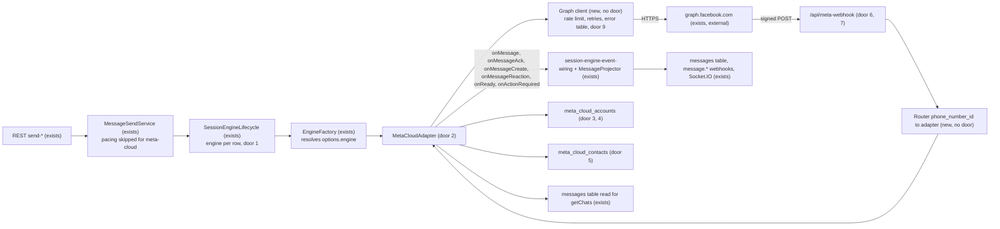
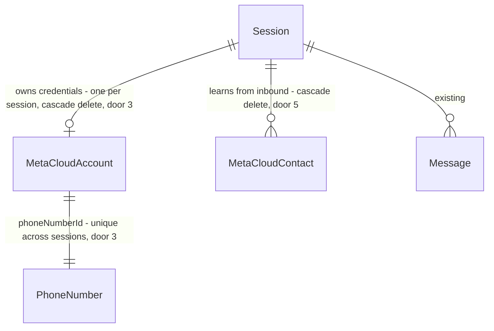

# Meta Cloud API sessions (doc 32, phases F1 + F2)

Sources:

- `docs/32-meta-cloud-api.md` - the adoption plan; this feature is its F1 (per-session engine) and F2 (minimal
  adapter + webhook). The file is uncommitted in the `meta-official-api-plan-32d1eb` worktree and comes into this
  branch at build start, corrected where the code check below found it wrong.
- Code check of doc 32 against `8c3fd921` - five claims corrected: matrix columns are `wwjs`/`baileys`
  (`engine-capability-matrix.ts:66`); `json()` keeping `rawBody` is in `src/configure-app.ts:258`, not `main.ts`;
  the `message.sent` webhook is dispatched by `message-projector.service.ts:763` (`message-send.service.ts:151` is
  a comment naming the `message:sent` hook); the campaign service is `campaigns.service.ts`; `GET /api/sessions`
  does **not** return `config` (`session-response.dto.ts:105`), it is served by `GET /api/sessions/:id/config`.
- Meta error-code reference (developers.facebook.com, business-messaging/whatsapp/support/error-codes) - the codes
  in the error table; `131030` is not on the current page and is dropped.
- Meta Graph API changelog - v26.0 is the newest version (announced 2026-07-29).

## Problem

Every OpenMsg session is a linked device: the gateway impersonates WhatsApp Web, so a number can be banned, a
WhatsApp client change breaks sessions until upstream ships a fix, and the anti-ban pacing caps how much the
business can send (`SEND_PACING_*`, on in production since 2026-10-08 per `OPENMSG.md`). A business that is willing
to register a number with Meta has no way to run that number through OpenMsg today: the engine is fixed once per
deployment by `ENGINE_TYPE` (`engine.factory.ts:43`), and only `whatsapp-web.js` and `baileys` are accepted
(`env.validation.ts:101`). The source gives no incident count or volume figure; the cost is a ban risk that is
accepted rather than measured.

When this ships, an operator can create a session bound to a WhatsApp Cloud API number next to the existing QR
session on the same gateway. That session sends and receives through the existing REST routes, webhooks and
Socket.IO. n8n and Hermes see the same payloads, except for the operations the Cloud API does not offer, which
answer 501.

## Out of scope

| Excluded                                                                                                                                                 | Why                                                                                                                                                    |
| -------------------------------------------------------------------------------------------------------------------------------------------------------- | ------------------------------------------------------------------------------------------------------------------------------------------------------ |
| Dashboard support for Cloud sessions (create form, badge, account panel, 24 h warning)                                                                   | doc 32 F3, its own feature. Until then a Cloud session is created through the API and shows in the existing Sessions page with the existing components |
| Meta templates, interactive messages, `send-template-meta`, `send-interactive`, `GET .../meta/templates`, the `meta` SDK resource                        | doc 32 F4 (D7)                                                                                                                                         |
| Campaigns on Cloud sessions (template campaigns, `tier_limit`, `CAMPAIGN_META_GAP_MS`)                                                                   | doc 32 F4 (D9); this feature only refuses them                                                                                                         |
| Profile and block-list methods (`setProfileStatus`, `setProfilePicture`, `deleteProfilePicture`, `blockContact`, `unblockContact`, `getBlockedContacts`) | doc 32 F5; they answer 501 here                                                                                                                        |
| `phone_number_quality_update`, `account_update`, `message_template_status_update` webhook fields                                                         | doc 32 F5; answered 200 and ignored here                                                                                                               |
| Multi-node webhook forwarding, Prometheus counters, `AuditAction` values                                                                                 | doc 32 F5                                                                                                                                              |
| Embedded Signup, Flows, calling API, catalog, coexistence, more than one Meta app per deployment                                                         | doc 32 §32.1                                                                                                                                           |
| `ENGINE_TYPE=meta-cloud` (a deployment where every session is Cloud)                                                                                     | the per-session column covers the need; doc 32 D1                                                                                                      |

## Assumptions

| Assumption                                                                     | Chosen default                                                                                                                                                          | Rationale                                                                                                                                                       | Confirmed? |
| ------------------------------------------------------------------------------ | ----------------------------------------------------------------------------------------------------------------------------------------------------------------------- | --------------------------------------------------------------------------------------------------------------------------------------------------------------- | ---------- |
| Scope of this feature                                                          | doc 32 F1 + F2 together; F3, F4, F5 each become a later feature                                                                                                         | F1 alone has no observable outcome for a user; F2 is the first slice someone can watch; confirmed 2026-10-11 with profile `standard`                            | y          |
| Which values `POST /api/sessions` accepts in `engine` (doc 32 open question 4) | only `meta-cloud`; Baileys vs whatsapp-web.js stays per deployment                                                                                                      | `purgeSessionData` and `ensurePrivateDir` treat the two QR engines as one pair (`engine.factory.ts:118,180`); opening the column to them is a separate decision | n          |
| Token storage (doc 32 open question 3)                                         | AES-256-GCM in the database, key in `.env` (`META_CLOUD_ENCRYPTION_KEY`)                                                                                                | the VM has no secret vault; same trust boundary as `API_KEY_PEPPER`                                                                                             | n          |
| Which existing number is used (doc 32 open question 1)                         | tests run against a fake Graph server via `META_GRAPH_BASE_URL`; acceptance on a real number waits for Meta credentials                                                 | building does not depend on a Meta account; see open question 1                                                                                                 | n          |
| Webhook fixtures before the F0 spike captures real bodies                      | written from Meta's documented payload examples, replaced by captured bodies when F0 runs                                                                               | the mapper is a pure function; fixture origin does not change its contract                                                                                      | n          |
| 24 h service window                                                            | no local pre-check; Meta's `131047` is mapped to 409 `META_OUTSIDE_SERVICE_WINDOW`                                                                                      | Meta is authoritative; a local clock refuses valid sends whenever a webhook arrived late                                                                        | n          |
| What `PUT .../meta/account` can change                                         | only `accessToken`; changing the number means a new session                                                                                                             | the guard that pins a session to its first phone refuses a READY whose phone differs from the row's (`session-engine-event-wiring.ts:230`)                      | n          |
| Outbound media                                                                 | the adapter loads media through the existing loaders (SSRF guard, `MEDIA_DOWNLOAD_MAX_BYTES`) and uploads it to `POST /<PHONE_NUMBER_ID>/media`; it never passes `link` | Meta cannot fetch private URLs, and loading through the existing loaders keeps the SSRF guard on every send                                                     | n          |
| Global rate limiter on the webhook                                             | `@SkipThrottle()` on both webhook routes; the HMAC check is the gate                                                                                                    | Meta posts in bursts from few IPs; the global `short` tier (10/s) would 429 inbound messages into Meta's backoff                                                | n          |
| SDK coverage for `GET/PUT /api/sessions/:id/meta/account`                      | resource `meta` goes into "Deliberately not exposed" (`sdk/README.md`, `docs/18`); F4 removes it when it adds the SDK resource                                          | token rotation is an operator action, like `settings` and `infra`                                                                                               | n          |
| Backup of the new tables                                                       | both excluded from `/infra` export with a reason; after a restore each Cloud session needs its token again                                                              | a backup file must not carry a permanent sending credential; contacts are rebuilt by the next inbound message                                                   | n          |
| Graph API version default                                                      | `v26.0`                                                                                                                                                                 | newest at the time of writing; `META_GRAPH_API_VERSION` overrides without a rebuild                                                                             | n          |

**Open questions:**

| #   | Kind           | Question                                                                                                           | Until answered                                                                                       |
| --- | -------------- | ------------------------------------------------------------------------------------------------------------------ | ---------------------------------------------------------------------------------------------------- |
| 1   | blocks go-live | Does the company already have a Meta app, WABA and number for this, or does F0 start from Meta's free test number? | Criteria are proven against a fake Graph server only; no real Cloud session can be created on the VM |
| 2   | blocks go-live | Who in the company completes Business verification, display-name approval and the payment method in Meta?          | A real number stays at the unverified tier (250 business-initiated conversations a day)              |

## Criteria

### S1: Per-session engine, QR sessions unchanged (P1)

**Acceptance Criteria**

1. The system SHALL return an `engine` field on every session in `GET /api/sessions` and `GET /api/sessions/:id`, equal to the row's `sessions.engine` when set and to the configured `ENGINE_TYPE` when the row's value is NULL
2. WHEN a session whose `sessions.engine` is NULL is started THEN the system SHALL create its engine from the `ENGINE_TYPE` plugin
3. WHEN a session whose `sessions.engine` is `meta-cloud` is started THEN the system SHALL create its engine from the `meta-cloud` plugin, whatever `ENGINE_TYPE` is
4. IF `POST /api/sessions` carries an `engine` value other than `meta-cloud` THEN the system SHALL respond 400 and create no session row
5. WHILE `META_CLOUD_ENABLED` is not `true` the system SHALL answer `POST /api/sessions` with `engine: "meta-cloud"` with 400 and `code: "META_CLOUD_DISABLED"`, and create no session row
6. WHEN the gateway boots with `META_CLOUD_ENABLED=true` THEN the system SHALL enable the `meta-cloud` engine plugin in addition to the `ENGINE_TYPE` plugin
7. IF a request disables the `meta-cloud` plugin while `META_CLOUD_ENABLED=true` THEN the system SHALL answer `success: false` and keep the plugin enabled
8. The system SHALL keep the existing migrations' session rows unchanged: after the migration every pre-existing row has `sessions.engine` NULL

**Independent test:** on a Baileys deployment, `GET /api/sessions` returns `engine: "baileys"` for an existing session, which starts and pairs as before.

### S2: Connect a Cloud session (P1)

**Acceptance Criteria**

9. WHEN `POST /api/sessions` carries `engine: "meta-cloud"` and `metaCloud: { phoneNumberId, wabaId, accessToken }` with `META_CLOUD_ENABLED=true` and a valid key THEN the system SHALL respond 201 and persist the session row and its `meta_cloud_accounts` row in one transaction
10. The system SHALL store the access token only encrypted: the persisted value SHALL differ from the plaintext and decrypt to it with `META_CLOUD_ENCRYPTION_KEY`
11. IF `META_CLOUD_ENCRYPTION_KEY` is unset or does not decode from base64 to exactly 32 bytes THEN the system SHALL answer a `meta-cloud` create with 400 and `code: "META_CLOUD_NOT_CONFIGURED"`, and persist nothing
12. IF `engine` is `meta-cloud` and `metaCloud` is missing or any of its three fields is empty THEN the system SHALL respond 400 and persist nothing
13. IF `metaCloud` is present and `engine` is not `meta-cloud` THEN the system SHALL respond 400 and persist nothing
14. IF the `phoneNumberId` is already bound to another session THEN the system SHALL respond 409 with `code: "META_PHONE_NUMBER_IN_USE"` and persist nothing
15. The system SHALL never write the access token, in plaintext or as a substring of 8 or more characters, into any HTTP response body, log line or webhook payload
16. WHEN a `meta-cloud` session starts and `GET /<PHONE_NUMBER_ID>` answers 200 THEN the system SHALL call `POST /<WABA_ID>/subscribed_apps` and move the session to `READY` with `phone` set to the digits of `display_phone_number` and `pushName` to `verified_name`
17. WHILE a `meta-cloud` session starts the system SHALL emit no `QR_READY` status and no QR event
18. IF Graph answers a start or a liveness probe with error code `190`, `10` or `200` THEN the system SHALL move the session to `ACTION_REQUIRED` with the reason `META_TOKEN_INVALID`
19. IF a `meta-cloud` session is started with no stored token THEN the system SHALL move it to `ACTION_REQUIRED` with the reason `META_TOKEN_MISSING` and make no Graph call
20. IF Graph is unreachable or answers 5xx during start THEN the system SHALL not move the session to `READY` and SHALL record the failure in `lastError`
21. WHEN the liveness watchdog probes a `READY` `meta-cloud` session THEN `probeLiveness()` SHALL return `true` on a 200 from `GET /<PHONE_NUMBER_ID>` and `false` on a network error or a 5xx
22. WHEN `POST /api/sessions/:id/pairing-code` targets a `meta-cloud` session THEN the system SHALL respond 501
23. WHEN `GET /api/sessions/:id/meta/account` targets a `meta-cloud` session THEN the system SHALL respond 200 with `phoneNumberId`, `wabaId`, `displayPhoneNumber`, `verifiedName`, `qualityRating`, `messagingLimitTier`, `accessTokenLast4` and `webhookUrl`, and without the token
24. IF `GET` or `PUT /api/sessions/:id/meta/account` targets a session whose `sessions.engine` is not `meta-cloud` THEN the system SHALL respond 501
25. WHEN `PUT /api/sessions/:id/meta/account` carries a new `accessToken` THEN the system SHALL replace the stored token and `accessTokenLast4`, and the session's next Graph call SHALL send `Authorization: Bearer <new token>`
26. WHEN a `meta-cloud` session is logged out THEN the system SHALL clear its stored token and move it to `DISCONNECTED`
27. WHEN a `meta-cloud` session is deleted THEN the system SHALL delete its `meta_cloud_accounts` row and its `meta_cloud_contacts` rows

**Independent test:** against the fake Graph server, create a Cloud session, start it, see `READY` with the test number's phone, then rotate the token and see the next request carry it.

### S3: Send through the Cloud API (P1)

**Acceptance Criteria**

28. WHEN `POST /api/sessions/:id/messages/send-text` targets a `READY` `meta-cloud` session THEN the system SHALL call `POST /<version>/<PHONE_NUMBER_ID>/messages` with `messaging_product: "whatsapp"`, `to` set to the chat's digits, `type: "text"` and `text.body`, and respond with `messageId` equal to the returned `wamid`
29. WHEN a Cloud send succeeds THEN the system SHALL persist the message with `waMessageId` equal to the `wamid` and dispatch exactly one `message.sent` webhook for it
30. WHEN a media send (`send-image`, `send-video`, `send-audio`, `send-document`, `send-sticker`) targets a `meta-cloud` session THEN the system SHALL upload the media to `POST /<PHONE_NUMBER_ID>/media` and send the message with the returned media `id`, never with `link`
31. WHEN `send-location`, `send-contact`, `reply` or `react` targets a `meta-cloud` session THEN the system SHALL send `type` `location`, `contacts`, the original type with `context.message_id`, or `reaction`, respectively
32. WHILE `SEND_PACING_ENABLED=true` the system SHALL neither count nor refuse sends on a `meta-cloud` session (no 429 `SEND_PACING_LIMITED`)
33. IF Graph answers a send with one of the error codes in the table below THEN the system SHALL respond with that row's HTTP status and `code`, and include `metaCode` and `fbtraceId` in the body
34. IF Graph answers `130429` THEN the system SHALL retry the same request at most 2 more times with backoff before responding 429 `META_RATE_LIMITED`
35. WHILE one phone number has `META_CLOUD_MAX_RPS` Graph calls in flight within the same second the system SHALL delay the next call for that number, not reject it
36. IF a Graph call exceeds `META_CLOUD_TIMEOUT_MS` or fails at the network level THEN the system SHALL abort it and respond 503

| Meta error code              | HTTP | `code`                        |
| ---------------------------- | ---- | ----------------------------- |
| `190`, `10`, `200`, `131005` | 409  | `META_TOKEN_INVALID`          |
| `131047`                     | 409  | `META_OUTSIDE_SERVICE_WINDOW` |
| `131048`, `131049`, `131056` | 429  | `META_LIMIT_REACHED`          |
| `130429` (after retries)     | 429  | `META_RATE_LIMITED`           |
| `131026`, `131021`           | 400  | `META_RECIPIENT_UNAVAILABLE`  |
| `131008`, `131009`           | 400  | `META_INVALID_PARAMETER`      |
| `133010`, `131031`           | 409  | `META_ACCOUNT_RESTRICTED`     |
| any other, or a Graph 5xx    | 502  | `META_UPSTREAM_ERROR`         |

**Independent test:** send a text and an image to the fake Graph server, see both bodies, the `wamid` in the response and one `message.sent` each; make the fake answer `131047` and see 409 `META_OUTSIDE_SERVICE_WINDOW`.

### S4: Receive through the Meta webhook (P1)

**Acceptance Criteria**

37. WHEN `GET /api/meta-webhook` carries `hub.mode=subscribe` and a `hub.verify_token` equal to `META_WEBHOOK_VERIFY_TOKEN` THEN the system SHALL respond 200 with `hub.challenge` as a `text/plain` body
38. IF the verify request has another `hub.mode`, a different token, or `META_WEBHOOK_VERIFY_TOKEN` is unset THEN the system SHALL respond 403
39. IF `POST /api/meta-webhook` has no `X-Hub-Signature-256` or one that is not `sha256=` + the HMAC-SHA256 of the raw body under `META_APP_SECRET` THEN the system SHALL respond 401 and process nothing
40. IF `META_APP_SECRET` is unset THEN the system SHALL answer `POST /api/meta-webhook` with 503 and log the cause once per process
41. WHILE `META_CLOUD_ENABLED` is not `true` the system SHALL answer both webhook routes with 404
42. WHEN a signed `POST /api/meta-webhook` arrives THEN the system SHALL respond 200 before the events in it are processed
43. WHEN a `messages` change carries an inbound text message for a phone number whose session is live in this process THEN the system SHALL dispatch `message.received` with `id` the `wamid`, `chatId` and `from` `<wa_id>@c.us`, the text, and the sender name from `contacts[].profile.name`
44. WHEN an inbound image, video, audio, document or sticker arrives THEN the system SHALL download it through `GET /<MEDIA_ID>` and the returned URL with the token, under the existing `MEDIA_DOWNLOAD_MAX_BYTES` cap
45. WHEN an inbound `reaction` arrives THEN the system SHALL deliver it through the existing reaction event
46. WHEN an inbound `interactive` or `button` reply arrives THEN the system SHALL deliver `message.received` with `button: { id, text }`
47. WHEN an inbound message has type `unsupported` or carries `errors` THEN the system SHALL deliver `message.received` with type `unknown` and the reason in `metadata`
48. WHEN a `statuses[]` entry with `sent`, `delivered` or `read` arrives THEN the system SHALL dispatch `message.ack` with that status for the `wamid`
49. WHEN a `statuses[]` entry with `failed` arrives THEN the system SHALL mark the message `failed` and dispatch `message.failed` carrying `errors[0].code`
50. WHEN the same inbound message is posted twice THEN the system SHALL persist one row and dispatch one `message.received`
51. WHEN a `read` status arrives before its `delivered` THEN the system SHALL leave the message at `read`
52. IF a change's `metadata.phone_number_id` matches no session live in this process THEN the system SHALL respond 200, dispatch nothing, and log the drop
53. WHEN one POST carries several `entry[]` and `changes[]` THEN the system SHALL process every one of them
54. WHEN an inbound message arrives THEN the system SHALL record its `wa_id`, profile name, time and `wamid` as the contact's last inbound message in `meta_cloud_contacts`

**Independent test:** sign a recorded `messages` body with the test secret, post it twice, and see one `message.received` on a test webhook; post it unsigned and see 401.

### S5: Read side and refusals (P2)

**Acceptance Criteria**

55. WHEN the chats of a `meta-cloud` session are listed THEN the system SHALL return one chat per `chatId` found in that session's `messages`, with the last message, the chat name and an unread count equal to the inbound messages newer than the chat's last `sendSeen`
56. WHEN a chat's history is read on a `meta-cloud` session THEN the system SHALL return that chat's most recent `limit` messages from the `messages` table, oldest first, as `ChatHistoryCapability.getChatHistory` specifies (`whatsapp-engine.interface.ts:1114`)
57. WHEN `getContactById` targets a `meta-cloud` session THEN the system SHALL answer from `meta_cloud_contacts`
58. WHEN `sendSeen` targets a chat with a recorded last inbound `wamid` THEN the system SHALL send `status: "read"` for that `wamid`
59. WHEN `sendChatState('typing')` targets a chat with a recorded last inbound `wamid` THEN the system SHALL send the typing indicator with it, and otherwise SHALL make no Graph call and resolve
60. The system SHALL answer every interface method that the `cloud` column of the capability matrix marks `not-available` with 501
61. IF `POST /api/sessions/:id/campaigns` targets a `meta-cloud` session THEN the system SHALL respond 400 with `code: "CAMPAIGN_ENGINE_UNSUPPORTED"` and create no campaign
62. The system SHALL publish the `cloud` column in `docs/29` with the same counts as `engine-capability-matrix.ts`

**Independent test:** after S4's inbound message, list the session's chats and see the sender with one unread message; call a group route and see 501.

## Traceability

| ID     | Slice | Criteria                                       | Status    |
| ------ | ----- | ---------------------------------------------- | --------- |
| ENG-01 | S1    | 1, 2, 3, 4, 5, 6, 7, 8                         | In checks |
| MCA-01 | S2    | 9, 10, 11, 12, 13, 14, 15                      | In checks |
| MCA-02 | S2    | 16, 17, 18, 19, 20, 21, 22                     | In checks |
| MCA-03 | S2    | 23, 24, 25, 26, 27                             | In checks |
| MCS-01 | S3    | 28, 29, 30, 31, 32                             | In checks |
| MCS-02 | S3    | 33, 34, 35, 36                                 | In checks |
| MCW-01 | S4    | 37, 38, 39, 40, 41, 42                         | In checks |
| MCW-02 | S4    | 43, 44, 45, 46, 47, 48, 49, 50, 51, 52, 53, 54 | In checks |
| MCR-01 | S5    | 55, 56, 57, 58, 59, 60, 61, 62                 | In checks |

## Observable

| Surface                                                                 | Decision                                                                    | Landing                                                                                                        |
| ----------------------------------------------------------------------- | --------------------------------------------------------------------------- | -------------------------------------------------------------------------------------------------------------- |
| API `POST /api/sessions`                                                | response shape                                                              | AC 1, 9                                                                                                        |
| API `POST /api/sessions`                                                | error shape and codes                                                       | AC 4, 5, 11, 12, 13, 14                                                                                        |
| API `POST /api/sessions`                                                | who may call it                                                             | existing - `@RequireUnscopedKey()` (`session.controller.ts:90`)                                                |
| API `POST /api/sessions`                                                | versioning                                                                  | n/a - fields are additive and optional; existing callers send neither                                          |
| API `POST /api/sessions`                                                | rate limit behaviour                                                        | existing - global throttler tiers (`app.module.ts:238`)                                                        |
| API `GET /api/sessions`, `GET /api/sessions/:id`                        | response shape                                                              | AC 1                                                                                                           |
| API `GET /api/sessions`, `GET /api/sessions/:id`                        | error shape and codes                                                       | existing - unchanged                                                                                           |
| API `GET /api/sessions`, `GET /api/sessions/:id`                        | who may call it                                                             | existing - unchanged                                                                                           |
| API `GET /api/sessions`, `GET /api/sessions/:id`                        | versioning                                                                  | n/a - one added field                                                                                          |
| API `GET /api/sessions`, `GET /api/sessions/:id`                        | rate limit behaviour                                                        | existing - global throttler                                                                                    |
| API `GET /api/sessions/:id/meta/account`                                | response shape                                                              | AC 23                                                                                                          |
| API `GET /api/sessions/:id/meta/account`                                | error shape and codes                                                       | AC 24; 404 for an unknown session is existing session-lookup behaviour                                         |
| API `GET /api/sessions/:id/meta/account`                                | who may call it                                                             | n/a - mirrors `GET /api/sessions/:id/config`'s fence; no new role is introduced                                |
| API `GET /api/sessions/:id/meta/account`                                | versioning                                                                  | n/a - new route                                                                                                |
| API `GET /api/sessions/:id/meta/account`                                | rate limit behaviour                                                        | existing - global throttler                                                                                    |
| API `PUT /api/sessions/:id/meta/account`                                | response shape                                                              | AC 25 (same body as AC 23)                                                                                     |
| API `PUT /api/sessions/:id/meta/account`                                | error shape and codes                                                       | AC 24, 25; 400 on a missing `accessToken` follows the DTO validation pipe                                      |
| API `PUT /api/sessions/:id/meta/account`                                | who may call it                                                             | existing - `@RequireUnscopedKey()`, the fence `POST /api/sessions` already uses for credentials                |
| API `PUT /api/sessions/:id/meta/account`                                | versioning                                                                  | n/a - new route                                                                                                |
| API `PUT /api/sessions/:id/meta/account`                                | rate limit behaviour                                                        | existing - global throttler                                                                                    |
| webhook `GET /api/meta-webhook`                                         | response shape                                                              | AC 37                                                                                                          |
| webhook `GET /api/meta-webhook`                                         | error shape and codes                                                       | AC 38, 41                                                                                                      |
| webhook `GET /api/meta-webhook`                                         | who may call it                                                             | AC 37 - anyone holding the verify token; `@Public()`                                                           |
| webhook `GET /api/meta-webhook`                                         | versioning                                                                  | n/a - Meta fixes the handshake parameters                                                                      |
| webhook `GET /api/meta-webhook`                                         | rate limit behaviour                                                        | n/a - `@SkipThrottle()`, see Assumptions                                                                       |
| webhook `POST /api/meta-webhook`                                        | response shape                                                              | AC 42 - empty 200                                                                                              |
| webhook `POST /api/meta-webhook`                                        | error shape and codes                                                       | AC 39, 40, 41, 52                                                                                              |
| webhook `POST /api/meta-webhook`                                        | who may call it                                                             | AC 39 - only a body signed with `META_APP_SECRET`                                                              |
| webhook `POST /api/meta-webhook`                                        | versioning                                                                  | n/a - the payload version follows the app's Graph version, set in Meta                                         |
| webhook `POST /api/meta-webhook`                                        | rate limit behaviour                                                        | n/a - `@SkipThrottle()`; Meta owns retries                                                                     |
| API `POST /api/sessions/:id/messages/send-*` on a Cloud session         | response shape                                                              | existing - unchanged `{ messageId, ... }`; AC 28                                                               |
| API `POST /api/sessions/:id/messages/send-*` on a Cloud session         | error shape and codes                                                       | AC 33, 34, 36, 60                                                                                              |
| API `POST /api/sessions/:id/messages/send-*` on a Cloud session         | who may call it                                                             | existing - unchanged                                                                                           |
| API `POST /api/sessions/:id/messages/send-*` on a Cloud session         | versioning                                                                  | n/a - no shape change                                                                                          |
| API `POST /api/sessions/:id/messages/send-*` on a Cloud session         | rate limit behaviour                                                        | AC 32, 35                                                                                                      |
| API `POST /api/sessions/:id/campaigns`                                  | error shape and codes                                                       | AC 61                                                                                                          |
| API `POST /api/sessions/:id/campaigns`                                  | response shape, who, versioning, rate limit                                 | existing - unchanged                                                                                           |
| outgoing webhooks `message.*`                                           | response shape                                                              | existing - same events and payloads; AC 29, 43, 48, 49                                                         |
| document `docs/29`                                                      | structure                                                                   | AC 62                                                                                                          |
| document `docs/06`, `docs/05`, `docs/18`, `sdk/README.md`, `OPENMSG.md` | structure, depth, next step                                                 | existing - the governance gates in `AGENTS.md` fix where each route, table, migration and exclusion is written |
| screen                                                                  | n/a - no screen is added or changed; dashboard support is F3 (Out of scope) |

## Flow

Reuses the whole session lifecycle, the send pipeline (`applySendingGate`, idempotency, persistence), the message
projector (dedup on `UQ_messages_sessionId_waMessageId`, forward-only acks), webhook dispatch and the inbound media
cap. The Cloud API is added as a third adapter behind `IWhatsAppEngine`, not as a channel beside it. The webhook
reuses `safeEqualStr` and the `rawBody` that `configure-app.ts` already keeps. It does not reuse the Integration
Fabric ingress, which hands events to plugin workers and not to the session's callbacks.

Send: controller → `MessageSendService` gate (pacing skipped when the row's engine is `meta-cloud`) → `PENDING`
row → adapter → Graph `POST /messages` → `wamid` → `SENT` row → adapter calls `onMessageCreate` (the Cloud API
does not echo sends) → projector dispatches `message.sent`. Later `statuses[]` advance the row through
`onMessageAck`.

Create: `POST /api/sessions` → `SessionService.create` → `MetaCloudAccountService.createSession` writes the session row and
its `meta_cloud_accounts` row in one transaction; the adapter reads the token back through `MetaCloudAccountStore`
on every Graph call, so `PUT .../meta/account` reaches the next call.

Receive: Meta → `POST /api/meta-webhook` → HMAC → 200 → router → adapter maps the change → `onMessage` → the
existing `message:received` hook, deduplicated insert and `message.received`.

## Relations

One-way constraints: `sessions.engine` nullable, NULL meaning the deployment engine (door 1);
`meta_cloud_accounts.phoneNumberId` unique (door 3); `meta_cloud_contacts` unique on session + `waId` (door 5).

## Surface

| Route                                                                        | In                                                                                                        | Out                                                                                                                                             | Status                                                            |
| ---------------------------------------------------------------------------- | --------------------------------------------------------------------------------------------------------- | ----------------------------------------------------------------------------------------------------------------------------------------------- | ----------------------------------------------------------------- |
| `POST /api/sessions` (changed)                                               | `name`, `config?`, `proxyUrl?`, `proxyType?`, `engine?`, `metaCloud?{phoneNumberId, wabaId, accessToken}` | session with `engine`                                                                                                                           | `201`, `400`, `409`                                               |
| `GET /api/sessions`, `GET /api/sessions/:id` (changed)                       | -                                                                                                         | sessions with `engine`                                                                                                                          | `200`, `404`                                                      |
| `GET /api/sessions/:id/meta/account`                                         | -                                                                                                         | `phoneNumberId` · `wabaId` · `displayPhoneNumber` · `verifiedName` · `qualityRating` · `messagingLimitTier` · `accessTokenLast4` · `webhookUrl` | `200`, `404`, `501`                                               |
| `PUT /api/sessions/:id/meta/account`                                         | `accessToken`                                                                                             | same as GET                                                                                                                                     | `200`, `400`, `404`, `501`                                        |
| `GET /api/meta-webhook`                                                      | `hub.mode`, `hub.verify_token`, `hub.challenge`                                                           | the challenge, `text/plain`                                                                                                                     | `200`, `403`, `404`                                               |
| `POST /api/meta-webhook`                                                     | Meta envelope, `X-Hub-Signature-256`                                                                      | empty                                                                                                                                           | `200`, `401`, `404`, `503`                                        |
| `POST /api/sessions/:id/messages/send-*` on a Cloud session (changed errors) | unchanged                                                                                                 | unchanged                                                                                                                                       | `400`, `409`, `429`, `501`, `502`, `503` added for Cloud sessions |
| `POST /api/sessions/:id/campaigns` (changed errors)                          | unchanged                                                                                                 | unchanged                                                                                                                                       | `400` with `CAMPAIGN_ENGINE_UNSUPPORTED` added                    |

## Landing

| One-way door                                                          | Literal shape                                                                                                                                                                                                                                                                                                                                                                                                                                                                                                                                                                                                              | Alternative rejected                                                                                                                                                                                                                                                               |
| --------------------------------------------------------------------- | -------------------------------------------------------------------------------------------------------------------------------------------------------------------------------------------------------------------------------------------------------------------------------------------------------------------------------------------------------------------------------------------------------------------------------------------------------------------------------------------------------------------------------------------------------------------------------------------------------------------------- | ---------------------------------------------------------------------------------------------------------------------------------------------------------------------------------------------------------------------------------------------------------------------------------- |
| 1. per-session engine column                                          | `sessions.engine varchar(30) NULL`; NULL = `ENGINE_TYPE`; the only value written is `meta-cloud`; no backfill                                                                                                                                                                                                                                                                                                                                                                                                                                                                                                              | backfilling `ENGINE_TYPE` into every row - freezes today's engine into existing rows and silently ends the `ENGINE_TYPE` switch that `purgeSessionData` and `docs/29` rely on                                                                                                      |
| 2. engine id and plugin                                               | plugin id and persisted value `meta-cloud`; `ENGINE_TYPE` stays `whatsapp-web.js` / `baileys` only; adapter files prefixed `meta-cloud-` with matrix key `cloud`                                                                                                                                                                                                                                                                                                                                                                                                                                                           | a third `ENGINE_TYPE` value - every QR-only route and the boot pairing logic would have to handle a deployment with no QR engine                                                                                                                                                   |
| 3. credentials table                                                  | `meta_cloud_accounts`, PK `sessionId` FK `sessions(id) ON DELETE CASCADE`, `UNIQUE(phoneNumberId)` as `UQ_meta_cloud_accounts_phoneNumberId`                                                                                                                                                                                                                                                                                                                                                                                                                                                                               | keys inside `sessions.config` - served whole by `GET /api/sessions/:id/config` and carried by every `/infra` export                                                                                                                                                                |
| 4. token at rest                                                      | AES-256-GCM, stored as `v1.<iv>.<tag>.<ciphertext>` (base64url), key = base64 32 bytes from `META_CLOUD_ENCRYPTION_KEY`; a key change means re-entering every token                                                                                                                                                                                                                                                                                                                                                                                                                                                        | plaintext column - one leaked database file or backup hands over a permanent sending credential                                                                                                                                                                                    |
| 5. contacts table                                                     | `meta_cloud_contacts`, `UNIQUE(sessionId, waId)` as `UQ_meta_cloud_contacts_sessionId_waId`, FK cascade                                                                                                                                                                                                                                                                                                                                                                                                                                                                                                                    | the Baileys chat-state or LID tables - Baileys-shaped, and purged with Baileys data                                                                                                                                                                                                |
| 6. webhook URL operators paste into Meta                              | `GET` and `POST /api/meta-webhook`, `@Public()`, `@SkipThrottle()`                                                                                                                                                                                                                                                                                                                                                                                                                                                                                                                                                         | `/api/meta/webhook` - `check-sdk-coverage.mjs:187` keys resources by first path segment, so it would share resource `meta` with `/api/sessions/:id/meta/*`, which F4 puts in the SDKs; the Integration Fabric ingress - delivers to plugin workers, not to the session's callbacks |
| 7. webhook status codes                                               | 200 for accepted, duplicate and unknown-number bodies; 401 bad signature; 403 failed verify; 404 disabled; 503 secret unset                                                                                                                                                                                                                                                                                                                                                                                                                                                                                                | a 4xx for an unknown `phone_number_id` - Meta retries non-2xx deliveries for days                                                                                                                                                                                                  |
| 8. session API fields                                                 | response `engine: string` (always set); request `engine?: "meta-cloud"`, `metaCloud?: { phoneNumberId, wabaId, accessToken }`                                                                                                                                                                                                                                                                                                                                                                                                                                                                                              | credentials through a second call after create - leaves a session row that cannot start                                                                                                                                                                                            |
| 9. machine-readable error codes                                       | `META_TOKEN_INVALID`, `META_OUTSIDE_SERVICE_WINDOW`, `META_LIMIT_REACHED`, `META_RATE_LIMITED`, `META_RECIPIENT_UNAVAILABLE`, `META_INVALID_PARAMETER`, `META_ACCOUNT_RESTRICTED`, `META_UPSTREAM_ERROR`, `META_CLOUD_DISABLED`, `META_CLOUD_NOT_CONFIGURED`, `META_PHONE_NUMBER_IN_USE`, `CAMPAIGN_ENGINE_UNSUPPORTED`; Meta's number travels as `metaCode`                                                                                                                                                                                                                                                               | Meta's numeric code alone - ties every n8n flow to Meta's code table                                                                                                                                                                                                               |
| 10. Cloud chat identity                                               | `chatId` and `from` = `<E.164 digits>@c.us`                                                                                                                                                                                                                                                                                                                                                                                                                                                                                                                                                                                | bare digits or `@s.whatsapp.net` - campaigns and the reply tagger match `@c.us` today                                                                                                                                                                                              |
| 11. precedent: an optional engine plugin enabled beside `ENGINE_TYPE` | factory registers `meta-cloud` and enables it when `META_CLOUD_ENABLED=true`; `plugins.service.ts` refuses to disable an enabled engine still in use                                                                                                                                                                                                                                                                                                                                                                                                                                                                       | a separate NestJS module outside the plugin system - `getAvailableEngines()` and `/infra/engines` would not list it                                                                                                                                                                |
| 12. SDK names for the engine fields (found in S1)                     | every SDK: `SessionResponse.engine` (string, always sent), `CreateSessionRequest.engine` and `.metaCloud`, and a new type `MetaCloudCredentials { phoneNumberId, wabaId, accessToken }`; Go `SessionEngine` with const `EngineMetaCloud`, Java enum `SessionEngine.META_CLOUD`; Java `CreateSessionRequest` keeps its four-argument constructor                                                                                                                                                                                                                                                                            | adding the fields only in F4 with the `meta` resource - `check:contract-shapes` fails the hand types as soon as the DTOs carry them, and a later rename breaks published SDK callers either way                                                                                    |
| 13. columns of the two Cloud tables (found in S2)                     | `meta_cloud_accounts`: `sessionId` PK, `phoneNumberId` varchar(64), `wabaId` varchar(64), `accessTokenEnc` text NULL, `accessTokenLast4` varchar(4) NULL, `displayPhoneNumber` varchar(32), `verifiedName` varchar(256), `qualityRating` varchar(20), `messagingLimitTier` varchar(30), `lastCheckedAt`, `createdAt`, `updatedAt` (all profile columns NULL until the first start); `meta_cloud_contacts`: `id` uuid PK, `sessionId`, `waId` varchar(32), `profileName` varchar(256), `lastInboundAt`, `lastInboundWamid` varchar(128), `lastSeenAt` (the `sendSeen` mark S5 counts unread from), `createdAt`, `updatedAt` | `meta_cloud_contacts` keyed on `(sessionId, waId)` with no `id`, and `lastSeenAt` added by S5 - a composite PK is the shape no other data table uses, and a second migration on a table this branch creates would follow the first one into the same release                       |

- No new dependency: the Graph client uses native `fetch` with `AbortSignal.timeout`, and the cipher uses
  `node:crypto`.
- Nothing else in this change is hard to reverse.

## Impact

| Front           | What changes                                                                                                                                                                                                                                                                                                                                                                                                                                                                                                                                                                                                                                                                                                                                                                                                                                                                                                                                                                                                                                  |
| --------------- | --------------------------------------------------------------------------------------------------------------------------------------------------------------------------------------------------------------------------------------------------------------------------------------------------------------------------------------------------------------------------------------------------------------------------------------------------------------------------------------------------------------------------------------------------------------------------------------------------------------------------------------------------------------------------------------------------------------------------------------------------------------------------------------------------------------------------------------------------------------------------------------------------------------------------------------------------------------------------------------------------------------------------------------------- |
| domain          | existing term: `ENGINE_TYPE` / `getCurrentEngine()` meant "the engine of every session", now means "the engine of sessions whose row has no engine". Code that branches on it today: `GET /infra/engines/current` (`infra-status.controller.ts:265`), the dashboard's global `engineType` from login, the plugin disable guard (`plugins.service.ts:168`), the factory call (`session-engine-lifecycle.service.ts:647`). Until F3, the dashboard applies the deployment engine's feature hiding to Cloud sessions too                                                                                                                                                                                                                                                                                                                                                                                                                                                                                                                         |
| domain          | new term: Cloud session - a session whose `engine` is `meta-cloud`; it has no QR, no pairing code, and a token instead of on-disk credentials. Lives in `src/engine/adapters/meta-cloud-*` and `src/modules/meta-cloud/`                                                                                                                                                                                                                                                                                                                                                                                                                                                                                                                                                                                                                                                                                                                                                                                                                      |
| domain          | existing term: "phone" on a session - for a Cloud session it is the digits of Meta's `display_phone_number`, and the guard that pins a session to its first phone (`session-engine-event-wiring.ts:230`) holds it fixed for the session's life                                                                                                                                                                                                                                                                                                                                                                                                                                                                                                                                                                                                                                                                                                                                                                                                |
| stored data     | `sessions.engine` added nullable with no backfill: every existing row stays NULL and keeps its behaviour. The two new tables start empty. Both are excluded from `/infra` export (`export-tables.ts`) with a reason, so a restore needs each Cloud token again                                                                                                                                                                                                                                                                                                                                                                                                                                                                                                                                                                                                                                                                                                                                                                                |
| configuration   | eight new variables (`META_CLOUD_ENABLED`, `META_APP_SECRET`, `META_WEBHOOK_VERIFY_TOKEN`, `META_CLOUD_ENCRYPTION_KEY`, `META_GRAPH_API_VERSION`, `META_GRAPH_BASE_URL`, `META_CLOUD_MAX_RPS`, `META_CLOUD_TIMEOUT_MS`), each in `.env.example`, both compose files and `BLANK_SHADOWED_ENV_KEYS`. With `META_CLOUD_ENABLED` unset, the VM's behaviour does not change                                                                                                                                                                                                                                                                                                                                                                                                                                                                                                                                                                                                                                                                        |
| upstream merges | small hook edits in `engine.factory.ts`, `engine.module.ts` (registers the Cloud account store), `engine-capability-matrix.ts`, `engine-parity.spec.ts`, `session.entity.ts`, `create-session.dto.ts`, `session-response.dto.ts`, `session.service.ts` (the create transaction and the pairing-code 501), `session.module.ts` (imports `MetaCloudModule`), `session.controller.ts` (declares the pairing-code 501), `session-engine-lifecycle.service.ts`, `send-pacing.service.ts`, `plugins.service.ts`, `plugin-lifecycle.ts` (lets `meta-cloud` be enabled beside `engine.type`), `env.validation.ts`, `swagger.config.ts`, `app.module.ts`, `campaigns.service.ts`, `export-tables.ts` (the two Cloud tables excluded) and `export-tables.parity.spec.ts` (an excluded table is not expected among the FK-flagged exports); the sessions rebuild in the migration-drift fixture and the field list in `session.controller.spec.ts` gain `engine`. The matrix is the likeliest conflict, since upstream edits it for every new capability |
