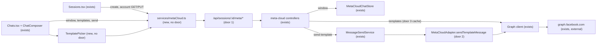

# Meta Cloud API sessions in the dashboard (doc 32, phase F3)

Sources:

- `docs/32-meta-cloud-api.md` §D10 and §F3 - the dashboard scope; F3 includes the 24 h warning and **Send template**,
  backed by a template list and a template send ("entregue aqui junto com `send-template-meta`").
- `.specs/features/meta-cloud-api/` - F1 + F2, merged in doughslima-cyber/OpenWA#6 (`33a2dac9`) and deployed
  2026-10-12. Its decisions AD-001..AD-005 in `.specs/STATE.md` constrain this feature.
- Dashboard map of `8c3fd921..33a2dac9`'s tree (2026-10-12): the `Session` type has no `engine`
  (`dashboard/src/services/api.ts:52`); the only engine branches read the global login `engineType`
  (`Chats.tsx:159`, `StatusComposeModal.tsx:31`); no per-message action is engine-gated; `awaitsPairing` and
  `canUnlinkSession` know nothing of engines (`utils/sessionActions.ts:35,41`); the campaign `errors` catalog lacks
  `CAMPAIGN_ENGINE_UNSUPPORTED`.
- Meta template reference (developers.facebook.com, whatsapp/templates/overview): list with
  `GET /<WABA_ID>/message_templates` (cursor `paging`), send with `type: "template"`, `template.language.code`,
  `components[].parameters[]` of `type: "text"`, and `parameter_name` when the template's `parameter_format` is
  `named`.
- User decisions 2026-10-12: F3 includes templates (list + send); the session detail shows the webhook URL only,
  never the verify token.

No design source: there are no mockups, so the screens below are specified by criteria and reviewed in the diff.

## Problem

A Cloud API session exists on the gateway but the dashboard cannot see it as one. The operator has to create it
with `curl`, the session card shows a QR placeholder while it starts, the Chats page offers actions the Cloud API
refuses (delete for everyone, clicking buttons, status, channels) and answers them with a generic error, and when
the customer's 24-hour service window has closed the operator has no way to reach them from the dashboard at all:
a free-text reply fails with `META_OUTSIDE_SERVICE_WINDOW`, and nothing in the product can send the approved
template Meta requires. The gateway has no route that lists or sends Meta templates. The source gives no usage
figure; the cost is that a Cloud session is API-only, which is the opposite of how OpenMsg is operated today
(every other session is run from the dashboard).

When this ships, an operator creates, starts, rotates the token of and chats through a Cloud session from the
dashboard alone, sees which actions apply to it, knows when the 24-hour window is closed, and sends an approved
template to reopen the conversation.

## Out of scope

| Excluded                                                                             | Why                                                                                                    |
| ------------------------------------------------------------------------------------ | ------------------------------------------------------------------------------------------------------ |
| Template campaigns, `tier_limit`, campaign template picker                           | doc 32 F4 (D9)                                                                                         |
| Interactive messages (buttons, lists) and templates with header or button parameters | doc 32 F4 (D7); the picker lists such templates as not sendable from the dashboard                     |
| The `meta` SDK resource                                                              | doc 32 F4; the new routes live under `/api/sessions/:id/meta/*`, already in "Deliberately not exposed" |
| Showing or returning `META_WEBHOOK_VERIFY_TOKEN`                                     | user decision 2026-10-12: URL only                                                                     |
| A per-deployment "Cloud enabled" flag exposed to the dashboard                       | the create form offers the option and translates `META_CLOUD_DISABLED`; see Assumptions                |
| Message Tester page support for Cloud sessions                                       | an API-testing page; its unsupported calls already answer 501                                          |
| Template status webhooks invalidating the template cache                             | doc 32 F5 (`message_template_status_update`)                                                           |
| Profile, block list, quality/restriction webhooks in the UI                          | doc 32 F5                                                                                              |

## Assumptions

| Assumption                                                               | Chosen default                                                                                                          | Rationale                                                                                                                                                                                   | Confirmed? |
| ------------------------------------------------------------------------ | ----------------------------------------------------------------------------------------------------------------------- | ------------------------------------------------------------------------------------------------------------------------------------------------------------------------------------------- | ---------- |
| F3 includes Meta templates                                               | list route, send route and a picker in Chats; header/button-parameter templates shown but not sendable                  | user decision 2026-10-12                                                                                                                                                                    | y          |
| Verify token in the session detail                                       | not shown; the detail shows the webhook URL with a copy button and names `META_WEBHOOK_VERIFY_TOKEN`                    | user decision 2026-10-12                                                                                                                                                                    | y          |
| Where the template routes live                                           | under `/api/sessions/:sessionId/meta/*`, not `/messages/*`                                                              | `check-sdk-coverage.mjs` keys resources by path segment: under `messages` every SDK must gain the method now (F4 scope); `meta` is already excluded and is the resource F4 adds to the SDKs | n          |
| How the dashboard learns the 24 h window                                 | a fork route returns the chat's last inbound time from `meta_cloud_contacts`                                            | adding it to `ChatSummary` edits the engine interface, five SDK types and the upstream DTO; the contact row already holds the value                                                         | n          |
| Whether the composer blocks free text when the window is closed          | free text stays possible, with a warning banner; a `META_OUTSIDE_SERVICE_WINDOW` answer is shown as its translated text | the gateway's clock can be wrong after a missed webhook; Meta is authoritative (same reasoning as the F2 assumption)                                                                        | n          |
| Showing the Cloud option on a deployment with `META_CLOUD_ENABLED` unset | the option is always shown; `META_CLOUD_DISABLED` is translated into how to enable it                                   | exposing the flag would edit `/auth/validate` (upstream); the error path already exists                                                                                                     | n          |
| Unlink on a Cloud session                                                | hidden; token rotation replaces it, delete removes the session                                                          | logout on a Cloud session only clears the token, which "Change token" does better                                                                                                           | n          |
| Template list freshness                                                  | cached 5 minutes per session; a **Refresh** action bypasses the cache                                                   | Meta approves templates in minutes to days; F5 adds webhook invalidation                                                                                                                    | n          |
| Template body rendering stored as the message text                       | the body text with parameters substituted, so Chats and `message.sent` show what the customer received                  | the existing local `send-template` stores rendered text the same way                                                                                                                        | n          |
| Profile                                                                  | `standard`                                                                                                              | no design source exists, so the `ui` comparison has nothing to compare                                                                                                                      | n          |

**Open questions:**

| #   | Kind           | Question                                                                                                  | Until answered                                                                                      |
| --- | -------------- | --------------------------------------------------------------------------------------------------------- | --------------------------------------------------------------------------------------------------- |
| 1   | blocks go-live | A Meta app, WABA, number and at least one approved template (carried from F1 + F2 open questions 1 and 2) | Criteria are proven against the fake Graph server; no real template can be listed or sent on the VM |

## Criteria

### S1: Create and manage a Cloud session from the Sessions page (P1)

**Acceptance Criteria**

1. The dashboard `Session` type SHALL carry `engine`, and every session-dependent decision in this feature SHALL read the session's `engine`, not the login `engineType`
2. WHEN the operator opens **New session** THEN the form SHALL offer two choices, "Linked device (QR)" (selected by default) and "Official Meta API"
3. WHILE "Official Meta API" is selected the form SHALL show three required fields - Phone Number ID, WABA ID and access token - each with a `label htmlFor`, the token as a password input
4. WHEN the form is submitted with "Official Meta API" THEN the dashboard SHALL send one `POST /api/sessions` with `{ name, engine: "meta-cloud", metaCloud: { phoneNumberId, wabaId, accessToken } }` and no proxy fields
5. IF any of the three Cloud fields is empty THEN the dashboard SHALL keep the submit button disabled and send nothing
6. IF the create answers with `code` `META_CLOUD_DISABLED`, `META_CLOUD_NOT_CONFIGURED` or `META_PHONE_NUMBER_IN_USE` THEN the dashboard SHALL show that code's translated text, not the raw message
7. The session card of a `meta-cloud` session SHALL show an "Official API" badge next to its status, and SHALL never show the QR placeholder, the **Show QR** button or **Unlink**
8. WHEN a `meta-cloud` session is started from the dashboard THEN the dashboard SHALL NOT open the QR modal
9. WHILE a `meta-cloud` session is `action_required` with the error `META_TOKEN_INVALID` or `META_TOKEN_MISSING` the card SHALL show a translated hint to change the token
10. WHEN the detail of a `meta-cloud` session is opened THEN it SHALL show display phone number, verified name, quality rating, messaging limit tier, the token as `•••• <last 4>`, and the webhook URL with a copy button and the text naming `META_WEBHOOK_VERIFY_TOKEN`, all read from `GET /api/sessions/:id/meta/account`
11. The detail of a `meta-cloud` session SHALL NOT show the auto-reject-calls toggle
12. WHEN the operator submits **Change token** with a non-empty token THEN the dashboard SHALL send `PUT /api/sessions/:id/meta/account` with `{ accessToken }`, show a success toast, clear the field and show the new last 4 characters
13. IF the account request fails THEN the detail SHALL show the error's translated text, or its message when the code has no translation, and keep the rest of the detail usable
14. The detail of a session whose `engine` is not `meta-cloud` SHALL be unchanged: no Cloud section and no `meta/account` request

**Independent test:** in a render test with a stubbed API, create a Cloud session through the form and see the exact POST body; open its detail and see the masked token and webhook URL; change the token and see the PUT.

### S2: Chats on a Cloud session (P1)

**Acceptance Criteria**

15. WHILE the selected session's `engine` is `meta-cloud` the Chats page SHALL hide the Status and Channels tabs
16. WHILE the selected session's `engine` is `meta-cloud` the message menu SHALL hide **Delete** and the interactive buttons SHALL render as plain, non-clickable labels; **Reply** and **React** stay
17. WHEN a chat of a `meta-cloud` session is opened THEN the dashboard SHALL request `GET /api/sessions/:id/meta/chats/:chatId/window`
18. WHILE that window is closed (`open: false`) the composer SHALL show a banner saying the 24-hour window is closed and a template is needed, with a **Send template** button
19. WHILE the window is open the composer SHALL show no banner and SHALL still offer **Send template** from its action area
20. IF a send answers with `code` `META_OUTSIDE_SERVICE_WINDOW`, `META_RECIPIENT_UNAVAILABLE`, `META_LIMIT_REACHED`, `META_RATE_LIMITED`, `META_TOKEN_INVALID` or `META_ACCOUNT_RESTRICTED` THEN the dashboard SHALL show that code's translated text
21. WHILE the selected session's `engine` is not `meta-cloud` the Chats page SHALL behave as before: no window request, no banner, no **Send template**, and the Channels tab still follows the login `engineType`

**Independent test:** render Chats with a stubbed Cloud session whose window is closed, see the banner and no Delete action; switch to a QR session and see the page unchanged.

### S3: Send an approved template (P1)

**Acceptance Criteria**

22. WHEN `GET /api/sessions/:id/meta/templates` targets a `meta-cloud` session THEN the system SHALL answer 200 with every template of the account's WABA, each with `name`, `language`, `status`, `category`, `parameterFormat` and `components`, following Graph paging until it ends or 500 templates are read
23. WHEN the template list is requested twice within 5 minutes for the same session THEN the system SHALL call Graph once, and SHALL call it again when the request carries `refresh=true`
24. IF the templates or window route targets a session whose `engine` is not `meta-cloud` THEN the system SHALL answer 501; IF the session does not exist THEN 404
25. WHEN `GET /api/sessions/:id/meta/chats/:chatId/window` targets a chat with a recorded inbound message THEN the system SHALL answer `{ lastInboundAt, open, closesAt }` where `closesAt` is `lastInboundAt` + 24 hours and `open` is `closesAt` later than now; for a chat with none it SHALL answer `{ lastInboundAt: null, open: false, closesAt: null }`
26. WHEN `POST /api/sessions/:id/meta/send-template` carries `{ chatId, name, language, parameters? }` for a `READY` `meta-cloud` session THEN the system SHALL send Graph `type: "template"` with `template.name`, `template.language.code` and, when parameters are given, one `body` component whose `parameters` are `{ type: "text", text }` in order (positional) or `{ type: "text", parameter_name, text }` (named, when `parameters` is an object), and SHALL answer 201 with `messageId` equal to the returned `wamid`
27. WHEN a template send succeeds THEN the system SHALL persist the message with the template body text with its parameters substituted, and dispatch exactly one `message.sent` for it
28. The template send SHALL pass through the same send gate as `send-text` (the `message:sending` plugin hook and the idempotency key), and SHALL refuse a chat outside a chat-restricted key's scope as `send-text` does
29. IF Graph answers a template send with a code from `132000` to `132016` THEN the system SHALL answer 400 with `code: "META_TEMPLATE_INVALID"` and `metaCode`; every other Graph error SHALL map through the F2 error table
30. IF the template send targets a session that is not `READY` THEN the system SHALL answer 409, and IF the body misses `chatId`, `name` or `language` THEN 400
31. WHEN the operator clicks **Send template** THEN the picker SHALL list the session's templates with `status` `APPROVED`, showing name, language and category, with a **Refresh** action
32. WHEN a template is selected THEN the picker SHALL show its body text and one labelled input per body placeholder (`{{1}}`, `{{2}}`, or `{{name}}`), and a live preview of the body with the inputs substituted
33. IF the selected template has a header with a variable or media, or buttons with parameters THEN the picker SHALL show it as not sendable from the dashboard and disable **Send**
34. WHILE any placeholder input is empty the picker SHALL keep **Send** disabled
35. WHEN the picker sends THEN the dashboard SHALL call the send route with the chat, the template's `name` and `language`, and the inputs as an array (positional) or an object keyed by placeholder name (named), close the picker, and show the sent message in the thread
36. IF the account has no `APPROVED` template THEN the picker SHALL show an empty state saying templates are created and approved in Meta's WhatsApp Manager

**Independent test:** against the fake Graph server, list templates, send a positional and a named template, and see the Graph bodies, the stored rendered text and one `message.sent`; in a render test, pick a template, fill its inputs, and see the POST body.

### S4: Campaigns page on a Cloud session (P2)

**Acceptance Criteria**

37. WHILE the selected campaign session's `engine` is `meta-cloud` the Campaigns page SHALL hide **New campaign** and show a note that Cloud API campaigns arrive with templates in a later version
38. IF a campaign request answers with `code` `CAMPAIGN_ENGINE_UNSUPPORTED` THEN the Campaigns page SHALL show its translated text

**Independent test:** render Campaigns with a Cloud session selected and see no **New campaign** button and the note.

### S5: Copy and conventions (P1)

**Acceptance Criteria**

39. The dashboard SHALL keep every string this feature adds under the same key in all 15 catalogs in `dashboard/src/i18n/locales/`, and `npm run i18n:check` SHALL exit 0
40. The dashboard SHALL scope every CSS rule this feature adds to a page stylesheet under that page's root class, and colors SHALL come from tokens (`--primary*`, `--success*`, existing status tokens), never a hex literal

**Independent test:** `npm run i18n:check`, the styles scope test and `npm run lint` in `dashboard/`.

## Traceability

| ID     | Slice | Criteria               | Status    |
| ------ | ----- | ---------------------- | --------- |
| MCD-01 | S1    | 1, 2, 3, 4, 5, 6       | In checks |
| MCD-02 | S1    | 7, 8, 9                | In checks |
| MCD-03 | S1    | 10, 11, 12, 13, 14     | In checks |
| MCD-04 | S2    | 15, 16, 21             | In checks |
| MCD-05 | S2    | 17, 18, 19, 20         | In checks |
| MCT-01 | S3    | 22, 23, 24, 25         | In checks |
| MCT-02 | S3    | 26, 27, 28, 29, 30     | In checks |
| MCT-03 | S3    | 31, 32, 33, 34, 35, 36 | In checks |
| MCD-06 | S4    | 37, 38                 | In checks |
| MCD-07 | S5    | 39, 40                 | In checks |

## Observable

| Surface                                               | Decision                            | Landing                                                                                                                              |
| ----------------------------------------------------- | ----------------------------------- | ------------------------------------------------------------------------------------------------------------------------------------ |
| screen Sessions / New session                         | empty state                         | n/a - a form; its empty state is the blank fields with submit disabled (AC 5)                                                        |
| screen Sessions / New session                         | loading state                       | existing - the submit button's pending state in `useSessionCreateForm`                                                               |
| screen Sessions / New session                         | error state                         | AC 6                                                                                                                                 |
| screen Sessions / New session                         | unauthorised state                  | existing - **New session** is shown only to keys that can write                                                                      |
| screen Sessions / New session                         | density and ordering                | AC 2, 3                                                                                                                              |
| screen Sessions / New session                         | destructive action confirms         | n/a - creating is not destructive                                                                                                    |
| screen Sessions / card                                | empty, loading, error, unauthorised | existing - the card list's states are unchanged; AC 7, 9 add to a card                                                               |
| screen Sessions / card                                | destructive action confirms         | existing - delete keeps its confirm; unlink is hidden (AC 7)                                                                         |
| screen Sessions / detail                              | loading state                       | AC 10 - the Cloud section shows the existing loading text while `meta/account` loads                                                 |
| screen Sessions / detail                              | error state                         | AC 13                                                                                                                                |
| screen Sessions / detail                              | unauthorised state                  | existing - **Change token** follows the write permission the detail already checks                                                   |
| screen Sessions / detail                              | destructive action confirms         | n/a - changing the token replaces a credential the operator just typed; no confirm, like the proxy form                              |
| screen Chats / thread and composer                    | empty state                         | existing - unchanged empty chat list and empty thread                                                                                |
| screen Chats / thread and composer                    | loading state                       | AC 17 - no banner until the window answer arrives                                                                                    |
| screen Chats / thread and composer                    | error state                         | AC 20; a failed window request shows no banner and leaves sending possible                                                           |
| screen Chats / thread and composer                    | unauthorised state                  | existing - composer hidden without write permission                                                                                  |
| screen Chats / template picker                        | empty state                         | AC 36                                                                                                                                |
| screen Chats / template picker                        | loading state                       | AC 31 - the existing spinner pattern while the list loads                                                                            |
| screen Chats / template picker                        | error state                         | AC 31, 20 - a failed list shows the error text with **Refresh**                                                                      |
| screen Chats / template picker                        | unauthorised state                  | existing - **Send template** lives in the composer, which needs write permission                                                     |
| screen Chats / template picker                        | density and ordering                | AC 31 - approved only, ordered by name then language                                                                                 |
| screen Campaigns                                      | empty, loading, error, unauthorised | existing - unchanged; AC 37, 38                                                                                                      |
| API `GET /api/sessions/:id/meta/templates`            | response shape                      | AC 22                                                                                                                                |
| API `GET /api/sessions/:id/meta/templates`            | error shape and codes               | AC 24, 29 (F2 table for Graph failures)                                                                                              |
| API `GET /api/sessions/:id/meta/templates`            | who may call it                     | existing - session-scoped read, same fence as `GET .../meta/account`                                                                 |
| API `GET /api/sessions/:id/meta/templates`            | versioning                          | n/a - new route                                                                                                                      |
| API `GET /api/sessions/:id/meta/templates`            | rate limit behaviour                | AC 23 (cache) and the existing global throttler                                                                                      |
| API `GET /api/sessions/:id/meta/chats/:chatId/window` | response shape                      | AC 25                                                                                                                                |
| API `GET /api/sessions/:id/meta/chats/:chatId/window` | error shape and codes               | AC 24                                                                                                                                |
| API `GET /api/sessions/:id/meta/chats/:chatId/window` | who may call it                     | AC 28's rule applied to reads - `@ChatScoped('fenced')`, as the history route                                                        |
| API `GET /api/sessions/:id/meta/chats/:chatId/window` | versioning                          | n/a - new route                                                                                                                      |
| API `GET /api/sessions/:id/meta/chats/:chatId/window` | rate limit behaviour                | existing - global throttler; one DB read                                                                                             |
| API `POST /api/sessions/:id/meta/send-template`       | response shape                      | AC 26                                                                                                                                |
| API `POST /api/sessions/:id/meta/send-template`       | error shape and codes               | AC 29, 30                                                                                                                            |
| API `POST /api/sessions/:id/meta/send-template`       | who may call it                     | AC 28                                                                                                                                |
| API `POST /api/sessions/:id/meta/send-template`       | versioning                          | n/a - new route                                                                                                                      |
| API `POST /api/sessions/:id/meta/send-template`       | rate limit behaviour                | existing - the F2 per-number Graph limiter and the global throttler                                                                  |
| document `docs/06`, `docs/32`, `OPENMSG.md`           | structure, next step                | existing - governance gates fix where routes and errors are written; `OPENMSG.md` gains "operate a Cloud session from the dashboard" |

## Flow

Reuses the F2 adapter, Graph client, error table and `MetaCloudChatStore` (its contact rows already hold the last
inbound time), the existing send pipeline in `MessageSendService` (gate, idempotency, pending row, `onMessageCreate`
echo), and on the dashboard the existing session queries, toasts, modal and composer components. No new page.

1. Sessions page reads `session.engine`; create posts `engine` + `metaCloud`; the Cloud detail reads and rotates
   through `GET`/`PUT .../meta/account` (both exist).
2. Chats reads the selected session's `engine`; for Cloud it asks the window route on chat open and gates tabs and
   actions locally.
3. **Send template**: the picker lists the templates route (door 1) - Graph through the client, cached per session), the
   operator fills the body placeholders, and the dashboard posts `.../meta/send-template`.
4. The send route (door 1) hands a template send to `MessageSendService` (exists), which runs the gate, writes the pending row with
   the rendered body, calls the adapter's template send, stores the `wamid` and lets the adapter's
   `onMessageCreate` echo produce `message.sent`.

## Relations

None - no stored-data shape change. The window reads `meta_cloud_contacts.lastInboundAt`, which F2 already writes;
the template cache is in memory.

## Surface

| Route                                                                     | In                                                                                | Out                                                                                             | Status                                                        |
| ------------------------------------------------------------------------- | --------------------------------------------------------------------------------- | ----------------------------------------------------------------------------------------------- | ------------------------------------------------------------- |
| `GET /api/sessions/:sessionId/meta/templates`                             | `refresh?`                                                                        | `templates[]` of `name` · `language` · `status` · `category` · `parameterFormat` · `components` | `200`, `404`, `409`, `501`, `502`, `503`                      |
| `GET /api/sessions/:sessionId/meta/chats/:chatId/window`                  | -                                                                                 | `lastInboundAt` · `open` · `closesAt`                                                           | `200`, `403`, `404`, `501`                                    |
| `POST /api/sessions/:sessionId/meta/send-template`                        | `chatId`, `name`, `language`, `parameters?` (array or object), `Idempotency-Key?` | `messageId` · `timestamp`                                                                       | `201`, `400`, `403`, `404`, `409`, `429`, `501`, `502`, `503` |
| `POST /api/sessions` (existing; the dashboard now sends the Cloud fields) | `name`, `engine: "meta-cloud"`, `metaCloud{phoneNumberId, wabaId, accessToken}`   | session with `engine`                                                                           | `201`, `400`, `409`                                           |

## Landing

| One-way door                     | Literal shape                                                                                                                                                                           | Alternative rejected                                                                                                                                                                                   |
| -------------------------------- | --------------------------------------------------------------------------------------------------------------------------------------------------------------------------------------- | ------------------------------------------------------------------------------------------------------------------------------------------------------------------------------------------------------ |
| 1. template and window routes    | `GET /api/sessions/:sessionId/meta/templates`, `GET /api/sessions/:sessionId/meta/chats/:chatId/window`, `POST /api/sessions/:sessionId/meta/send-template`                             | `POST .../messages/send-template-meta` (doc 32 D7) - `check-sdk-coverage.mjs` would require the method in all five SDKs now, and it puts a Cloud-only verb into the engine-neutral `messages` resource |
| 2. template send body            | `{ chatId, name, language, parameters?: string[] \| Record<string, string> }`; an array means positional, an object means named                                                         | separate `positionalParameters` / `namedParameters` fields - two fields for one choice, and a body carrying both has no meaning                                                                        |
| 3. template list shape and cache | `{ templates: [{ name, language, status, category, parameterFormat, components }] }` passing Meta's `components` through unchanged; 5-minute per-session cache, `refresh=true` bypasses | a normalised component model - F4's interactive and header-media templates would need it reshaped, and Meta's shape is the documented one operators already know                                       |
| 4. template error code           | Graph `132000`-`132016` → 400 `META_TEMPLATE_INVALID` with `metaCode`, added to the F2 table (AD-004)                                                                                   | leaving them in `META_UPSTREAM_ERROR` 502 - a template mistake is the caller's, and a 5xx would hold its idempotency key as unknown                                                                    |
| 5. window payload                | `{ lastInboundAt: string \| null, open: boolean, closesAt: string \| null }`, ISO 8601 UTC                                                                                              | a bare boolean - the dashboard could not show when the window closes, and a cached boolean goes stale                                                                                                  |

- Nothing else in this change is hard to reverse.

## Impact

| Front           | What changes                                                                                                                                                                                                                                                                                                                                                                                                                                                                                           |
| --------------- | ------------------------------------------------------------------------------------------------------------------------------------------------------------------------------------------------------------------------------------------------------------------------------------------------------------------------------------------------------------------------------------------------------------------------------------------------------------------------------------------------------ |
| domain          | existing term: the login `engineType` meant "the engine of every session" to the dashboard; it now means "the engine of sessions whose `engine` is not `meta-cloud`". Code that branches on it: `Chats.tsx:159` (Channels tab), `StatusComposeModal.tsx:31` (recipient list) - both keep using it for QR sessions only                                                                                                                                                                                 |
| domain          | new term: service window - the 24 hours after the customer's last inbound message, during which free text is allowed; lives in `src/modules/meta-cloud/` and the composer                                                                                                                                                                                                                                                                                                                              |
| stored data     | nothing to migrate; no schema change                                                                                                                                                                                                                                                                                                                                                                                                                                                                   |
| upstream merges | small edits in `MessageSendService` (a template send kind), `Sessions.tsx`, `Chats.tsx`, `ChatThread.tsx`, `ChatComposer.tsx`, `ChatSidebar.tsx`, `Campaigns.tsx`, `useSessionCreateForm.ts`, `utils/sessionActions.ts`, `services/api.ts` (`Session.engine`, create body); new code in fork files (`services/metaCloud.ts`, `hooks/useMetaCloud.ts`, `components/chats/TemplatePicker.tsx`, `components/sessions/MetaCloudFields.tsx` and `MetaCloudAccountPanel.tsx`, the meta-cloud backend module) |
