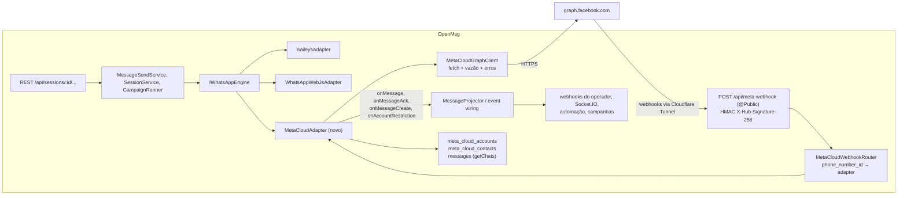

# 32 - API oficial da Meta (WhatsApp Cloud API): plano de adoção

> **Status:** F1 e F2 implementadas no ramo `claude/tlc-spec-lean-meta-cloud-api-5902e1` (OpenMsg); F3, F4 e F5
> continuam propostas. O documento descreve como o OpenMsg passa a
> aceitar, lado a lado com as sessões de dispositivo vinculado (Baileys e whatsapp-web.js), sessões ligadas à
> **WhatsApp Business Platform / Cloud API**, a API oficial da Meta. O documento é em português porque é parte
> do fork; os documentos do projeto original continuam em inglês.

## 32.1 Objetivo

Hoje toda sessão do OpenMsg é um "telefone vinculado": o gateway finge ser um WhatsApp Web, lê QR code, mantém um
socket e sofre as restrições de uma API não oficial (banimento, quedas quando o WhatsApp muda, cotas do
anti-banimento). A Cloud API elimina esse risco para os números que a empresa quiser registrar oficialmente, ao
custo de regras próprias: janela de 24 horas, modelos aprovados pela Meta, cobrança por mensagem e menos
funcionalidades (sem grupos, etiquetas, status, histórico ou lista de contatos).

O objetivo é que o operador escolha, **por sessão**, entre os dois modos, e que tudo o que já existe em volta da
sessão continue igual: a API REST (`/api/sessions/:id/messages/send-text`...), os webhooks (`message.received`,
`message.ack`...), o Socket.IO, o painel (**Conversas**, **Webhooks**, **Campanhas**), as regras de automação, os
plugins e os SDKs. Quem integra pelo n8n ou pelo Hermes não deve perceber por qual caminho a mensagem saiu, exceto
onde a Cloud API realmente não oferece a função (resposta 501, como já acontece entre Baileys e whatsapp-web.js).

Fora do escopo desta primeira adoção: Embedded Signup (cadastro do cliente pelo login do Facebook), WhatsApp
Flows, a API de chamadas, catálogo e carrinho pela Cloud API, coexistência do mesmo número no aplicativo e na API,
e mais de um aplicativo Meta por implantação.

## 32.2 O que a Cloud API muda (resumo do que importa para o desenho)

| Assunto          | Na Cloud API                                                                                                                                                                                                                                                                                                                                        | Equivalente no OpenMsg hoje                                                     |
| ---------------- | --------------------------------------------------------------------------------------------------------------------------------------------------------------------------------------------------------------------------------------------------------------------------------------------------------------------------------------------------- | ------------------------------------------------------------------------------- |
| Identidade       | Um **aplicativo Meta** (App ID, App Secret), uma **conta WhatsApp Business** (WABA ID) e um ou mais **números** (Phone Number ID). As chamadas usam um **token de usuário de sistema** (permanente) com as permissões `whatsapp_business_messaging` e `whatsapp_business_management`.                                                               | QR code ou código de pareamento; credenciais em `data/baileys/<id>/`            |
| Envio            | `POST https://graph.facebook.com/<versão>/<PHONE_NUMBER_ID>/messages` com `{ messaging_product: "whatsapp", to: "5511...", type, ... }`. A resposta traz `messages[0].id` (um `wamid.…`).                                                                                                                                                           | `engine.sendTextMessage(chatId, text)` devolve `{ id, timestamp }`              |
| Tipos            | `text`, `image`, `audio`, `video`, `document`, `sticker`, `location`, `contacts`, `reaction`, `interactive` (botões, lista, CTA), `template`. Não há enquete, encaminhamento, edição nem apagar para todos.                                                                                                                                         | Os `send-*` de `docs/06 §6.4.3`                                                 |
| Mídia            | Saída: `POST /<PHONE_NUMBER_ID>/media` (multipart) devolve um `media id`, ou `link` público. Entrada: o webhook traz só o `media id`; `GET /<MEDIA_ID>` devolve uma URL temporária (minutos) que se baixa com o token.                                                                                                                              | Os adapters baixam a mídia e entregam base64 em `IncomingMessage.media`         |
| Recebimento      | **Webhooks**: um único callback por aplicativo Meta. `GET` de verificação (`hub.mode`, `hub.verify_token`, `hub.challenge`) e `POST` assinado com `X-Hub-Signature-256` (HMAC-SHA256 do corpo bruto com o App Secret). O campo `messages` traz `messages[]` e `statuses[]`; outros campos trazem qualidade do número, status de modelos e da conta. | Eventos do socket viram `EngineEventCallbacks` (`onMessage`, `onMessageAck`...) |
| Entrega          | O receptor precisa responder 200 rápido; a Meta reenvia com recuo exponencial por dias e **pode duplicar**.                                                                                                                                                                                                                                         | `UNIQUE(sessionId, waMessageId)` em `messages` já deduplica                     |
| Janela de 24 h   | Texto livre só nas 24 horas após a última mensagem do cliente. Fora dela, só **modelo aprovado** (`template`). Erro `131047` quando a janela fechou.                                                                                                                                                                                                | Não existe o conceito; a campanha manda texto livre para números frios          |
| Limites          | Vazão de dezenas de mensagens por segundo por número; **conversas iniciadas pela empresa** limitadas por faixa (250 por dia sem verificação, depois 1 000, 10 000, 100 000, ilimitado), que sobe com a qualidade do número (`GREEN`/`YELLOW`/`RED`). Erros `130429` (vazão), `131048`/`131049` (faixa).                                             | Anti-banimento `SEND_PACING_*` (cotas diárias e disjuntor)                      |
| Custo            | Conversa de serviço (o cliente escreveu) gratuita; modelos de marketing, utilidade e autenticação cobrados por mensagem. Preço por país na documentação da Meta.                                                                                                                                                                                    | Gratuito                                                                        |
| Lido e digitando | `POST .../messages { status: "read", message_id }`, opcionalmente com `typing_indicator`. Só para uma mensagem recebida.                                                                                                                                                                                                                            | `sendSeen`, `sendChatState('typing')`                                           |
| Perfil           | `GET/POST /<PHONE_NUMBER_ID>/whatsapp_business_profile` (sobre, descrição, endereço, e-mail, site, foto). O nome de exibição passa por aprovação da Meta.                                                                                                                                                                                           | `setProfileStatus`, `setProfilePicture`; `setProfileName`                       |
| Modelos          | `GET/POST /<WABA_ID>/message_templates` com status `APPROVED`, `PENDING`, `REJECTED`, categorias `MARKETING`, `UTILITY`, `AUTHENTICATION`, parâmetros posicionais ou nomeados.                                                                                                                                                                      | Os "modelos" atuais (`/templates`) são textos locais com variáveis              |
| Versão da API    | A Graph API tem versões trimestrais com cerca de dois anos de vida. A versão vira configuração (`META_GRAPH_API_VERSION`); a implementação começa na versão corrente no dia e registra qual é.                                                                                                                                                      | n/a                                                                             |
| Bloqueio         | `POST/DELETE/GET /<PHONE_NUMBER_ID>/block_users`.                                                                                                                                                                                                                                                                                                   | `blockContact`, `unblockContact`, `getBlockedContacts`                          |
| O que não existe | Lista de contatos, lista de conversas, histórico, presença dos outros, grupos, etiquetas, status/stories, canais, enquetes, encaminhar, editar, apagar, favoritar, fixar, verificar se um número tem WhatsApp.                                                                                                                                      | Tudo isso existe em pelo menos um dos motores                                   |

Um número é de um modo só: um número registrado na Cloud API não pode ser pareado por QR, e vice-versa. A adoção
começa com um número **diferente** do que está vinculado hoje na VM.

## 32.3 Decisões de desenho

### D1. O modo é da sessão, e a Cloud API é um terceiro motor por trás de `IWhatsAppEngine`

Toda funcionalidade do gateway passa pela interface neutra `IWhatsAppEngine` (113 métodos, `docs/29 §29.2`): o
projetor de mensagens, os webhooks, o Socket.IO, as campanhas, as regras de automação e os plugins só conhecem
essa interface. Implementar a Cloud API como um **adapter** dessa interface é o que faz tudo isso funcionar sem
alteração. A alternativa, um "canal" novo fora da abstração de motor, duplicaria o projetor, os webhooks e a
página de conversas, e seria uma segunda base de código para manter a cada merge do upstream.

Hoje o motor é escolhido **uma vez por implantação**, por `ENGINE_TYPE` (`src/config/configuration.ts:221`,
`src/engine/engine.factory.ts`). Para a Cloud API conviver com o Baileys no mesmo gateway, a escolha passa a ser
**por sessão**:

- Coluna nova `sessions.engine` (`varchar(30)`, nula). `NULL` significa "o motor da implantação", exatamente o
  comportamento de hoje para todas as sessões existentes. O único valor aceito na criação é `meta-cloud`: a
  escolha entre Baileys e whatsapp-web.js continua sendo da implantação, porque os dois deixam credenciais em disco
  que a fábrica endurece e apaga em par (`purgeSessionData`), e `docs/29` descreve esse par como global.
- `EngineCreateOptions` ganha `engine?: string`; `EngineFactory.create()` resolve `options.engine ?? engineType`.
  A fábrica registra o plugin `meta-cloud` ao lado dos dois atuais e o habilita quando `META_CLOUD_ENABLED=true`.
  `plugins.service.ts` passa a recusar desabilitar o `meta-cloud` enquanto ele estiver habilitado, além do de
  `ENGINE_TYPE`. `ENGINE_TYPE` continua aceitando só `whatsapp-web.js` e `baileys`.
- `SessionResponseDto` ganha `engine` (sempre preenchido: o valor da linha ou o padrão), para o painel e os SDKs
  distinguirem a sessão sem consultar `/infra/engines/current`.
- A matriz de capacidades (`engine-capability-matrix.ts`, `MethodCapability`) ganha a coluna `cloud` ao lado
  de `wwjs` e `baileys` (`engine-capability-matrix.ts:66`), e `engine-parity.spec.ts` ganha o terceiro `AdapterKey`, com o prefixo de arquivo `meta-cloud-` identificando o
  motor (hoje `baileys*` e `wwebjs-*`). O contrato continua o mesmo: o que o motor não faz lança
  `EngineNotSupportedError` (501) na fronteira do adapter, nunca um sucesso fabricado.

### D2. Credenciais em tabela própria, cifradas, nunca devolvidas pela API

O token de usuário de sistema envia mensagens em nome da empresa e dura indefinidamente. Ele não entra em
`sessions.config` (que `GET /api/sessions/:id/config` devolve inteiro) nem em `.env` (há um token por número).

- Tabela `meta_cloud_accounts` (banco `data`): `sessionId` (PK, FK para `sessions`), `phoneNumberId` (único),
  `wabaId`, `accessTokenEnc` (AES-256-GCM), `accessTokenLast4`, `displayPhoneNumber`, `verifiedName`,
  `qualityRating`, `messagingLimitTier`, `lastCheckedAt`, `createdAt`, `updatedAt`.
- A chave vem de `META_CLOUD_ENCRYPTION_KEY` (32 bytes em base64). Sem ela, criar uma sessão `meta-cloud` responde
  400 `META_CLOUD_NOT_CONFIGURED`; as sessões de QR não são afetadas. A chave fica no `.env` da VM, como
  `API_KEY_PEPPER`.
- O App Secret e o verify token são da implantação (um aplicativo Meta, um callback): `META_APP_SECRET` e
  `META_WEBHOOK_VERIFY_TOKEN`. Uma coluna `appSecretEnc` por conta fica para uma versão futura com vários
  aplicativos.
- O token nunca aparece em log, resposta ou exportação. `GET /api/sessions/:id/meta/account` devolve os campos
  públicos e `accessTokenLast4`. `PUT` no mesmo caminho troca só o token (rotação) sem recriar a sessão; trocar de número exige uma sessão nova.
- O export/import de dados de `/infra` leva a conta (`metaCloudAccounts`) **sem o token**: `accessTokenEnc` e
  `accessTokenLast4` ficam fora do export e o import nunca os grava, então, após restaurar um backup, cada conta
  Cloud volta com o token NULL e precisa dele de novo por `PUT .../meta/account` (decisão de 2026-10-12, AD-005;
  antes a tabela inteira ficava fora, e a sessão restaurada não tinha conta para receber o token). Os contatos
  (`meta_cloud_contacts`) ficam fora do backup.

### D3. Ciclo de vida sem QR

O adapter mapeia o ciclo de vida de `docs/31` assim:

| Verbo / estado               | Cloud API                                                                                                                                                                                                                                                                                                                                                              |
| ---------------------------- | ---------------------------------------------------------------------------------------------------------------------------------------------------------------------------------------------------------------------------------------------------------------------------------------------------------------------------------------------------------------------- |
| `initialize(callbacks)`      | `GET /<PHONE_NUMBER_ID>?fields=display_phone_number,verified_name,quality_rating,messaging_limit_tier` com o token; `POST /<WABA_ID>/subscribed_apps` (idempotente) para garantir que o aplicativo recebe os webhooks da conta; registra o adapter no roteador de webhooks; chama `onReady(displayPhoneNumber, verifiedName)`. Não há `QR_READY` nem `AUTHENTICATING`. |
| `getQRCode()`                | `null`. `requestPairingCode()` lança 501. O painel não abre o modal de QR para essa sessão.                                                                                                                                                                                                                                                                            |
| `disconnect()` / `destroy()` | Remove o adapter do roteador; webhooks que chegarem para esse número respondem 200 e são descartados com um contador. Estado `DISCONNECTED`.                                                                                                                                                                                                                           |
| `logout()`                   | O mesmo que `disconnect()`, mais apagar o token da conta (`accessTokenEnc = NULL`). Religar exige um token novo, o paralelo de "exige QR de novo".                                                                                                                                                                                                                     |
| `probeLiveness()`            | `GET /<PHONE_NUMBER_ID>` a cada verificação do watchdog, com cache de alguns minutos: `true` em 200, `false` em erro de rede ou 5xx. Token recusado (`190`) não é "morto": vira `onActionRequired('META_TOKEN_INVALID')` e o estado `ACTION_REQUIRED`, que já existe.                                                                                                  |
| Reconexão                    | Não há socket: a política de reconexão (`reconnect-policy.ts`) age só quando o `probeLiveness` falha, e a "reconexão" é um novo `initialize`.                                                                                                                                                                                                                          |
| Restrição da conta           | O webhook `phone_number_quality_update` com `RED` ou `FLAGGED`/`RESTRICTED` vira `onAccountRestriction({...})`, o mesmo caminho das restrições do Baileys: a campanha para (`waitReason: restricted`) e o painel mostra o aviso. Voltar a `GREEN`/`CONNECTED` limpa.                                                                                                   |
| Auto-start no boot           | Funciona sem mudança: `onReady` grava `phone`, e o boot só religa sessões com `phone` preenchido (`session.service.ts:250`).                                                                                                                                                                                                                                           |

### D4. Receptor de webhooks da Meta

A Integration Fabric (`docs/25`) já responde o `hub.challenge` e confere HMAC, mas entrega para plugins em worker,
com fila e DLQ próprias. O motor precisa que o evento chegue aos `EngineEventCallbacks` da sessão no processo que
a hospeda, então ele ganha uma rota própria e pequena, reaproveitando as funções de assinatura
(`ingress-signature.ts`) e o `req.rawBody` que o `json()` de `src/configure-app.ts` já guarda.

- `GET /api/meta-webhook`: confere `hub.verify_token` com `META_WEBHOOK_VERIFY_TOKEN` (comparação de tempo
  constante) e devolve `hub.challenge` em texto puro; qualquer outra coisa é 403.
- `POST /api/meta-webhook`: confere `X-Hub-Signature-256` sobre `req.rawBody` (401 se faltar ou não bater; 503 e um
  log único se `META_APP_SECRET` não estiver definido), responde **200 imediatamente** e processa o corpo em
  seguida, fora da resposta. Para cada `entry[].changes[]`:
  - `field: messages` → localiza a sessão por `value.metadata.phone_number_id` no roteador. `messages[]` viram
    `onMessage(IncomingMessage)`; `statuses[]` viram `onMessageAck(wamid, status, chatId)`, com `failed` levando
    `errors[0]` para o `message.failed`.
  - `field: phone_number_quality_update` e `account_update` → `onAccountRestriction` (D3) e um log.
  - `field: message_template_status_update` → invalida o cache de modelos da conta e emite um log.
  - Número sem sessão viva neste processo → descarta com o contador `meta_cloud_webhook_dropped_total`.
- Deduplicação: `messages[]` cai no oráculo `UNIQUE(sessionId, waMessageId)` do projetor, que já trata o reenvio
  do mesmo evento; `statuses[]` só avançam o status (`handleMessageAck` é "forward-only"), então repetição é
  inofensiva.
- Multi-nó (`docs/13`): na primeira versão a rota só atende sessões hospedadas no processo que recebeu a chamada;
  a VM é um nó só. A evolução natural é encaminhar para `nodeUrl` do dono, como as rotas de sessão já fazem.
- A rota é `@Public()`: entra em `PUBLIC_PATHS` (`swagger.config.ts`) e nas duas listas de
  `swagger.config.spec.ts`; fica fora do limitador global de taxa (`@SkipThrottle()`), com a assinatura HMAC como porta; e fica listada em `docs/06` com os erros
  declarados.

### D5. Identidades e mapeamento de mensagens

- `chatId` e `from` são `<dígitos E.164>@c.us`, o mesmo formato que o Baileys produz e que a campanha gera. A Cloud
  API não tem `@lid`.
- `IncomingMessage.id` é o `wamid`; `contact.pushName` vem de `contacts[].profile.name`, que o projetor já usa como
  `chatName` (`message-projector.service.ts:398`); `senderPhone` é o `wa_id`.
- Tipos: `text` → `text`; `image`/`video`/`audio`/`document`/`sticker` → o mesmo, com o download pela
  `GET /<MEDIA_ID>` respeitando `MEDIA_DOWNLOAD_MAX_BYTES` e a concorrência de `inbound-media-cap.ts`; `location`;
  `contacts` → `contact`; `reaction` → `onMessageReaction`; `interactive`/`button` → `button: { id, text }`;
  `order` → `order`; `unsupported` e `errors` → `unknown` com o motivo em `metadata`.
- `context.id` vira `quotedMessage`; `referral` (anúncio clique-para-WhatsApp) vai para `metadata.referral`.
- Eco do envio: a Cloud API não ecoa a própria mensagem, e o webhook `message.sent` só nasce de `onMessageCreate`,
  despachado pelo projetor (`message-projector.service.ts:763`). O adapter chama `onMessageCreate` ele mesmo após cada envio com sucesso.
- Tabela auxiliar `meta_cloud_contacts` (`sessionId`, `waId`, `profileName`, `lastInboundAt`, `lastInboundWamid`):
  é o que permite responder `getContactById`, decidir a janela de 24 horas antes de chamar a Meta e usar o
  indicador de digitação (que exige o `wamid` da última mensagem recebida).

### D6. O que o motor responde, método a método

Coluna `cloud` da matriz (`docs/29 §29.4` ganha a coluna; aqui só o resumo). `✅ (store)` significa servido do
próprio banco do gateway, como já acontece com os status.

| Grupo (`docs/29`)         | Suportado                                                                                                                                                                               | 501 (`library-limitation`, salvo nota)                                                                                                                                                              |
| ------------------------- | --------------------------------------------------------------------------------------------------------------------------------------------------------------------------------------- | --------------------------------------------------------------------------------------------------------------------------------------------------------------------------------------------------- |
| Sessão e conexão          | `initialize`, `disconnect`, `logout`, `destroy`, `forceDestroy`, `getStatus`, `probeLiveness`, `getQRCode` (sempre `null`), `getPhoneNumber`, `getPushName`                             | `requestPairingCode`                                                                                                                                                                                |
| Envio                     | `sendTextMessage` (sem `mentions`; `linkPreview` vira `preview_url`), imagem, vídeo, áudio (PTT vira `audio`), documento, figurinha, localização, contato, `replyToMessage` (`context`) | `sendPollMessage`, `forwardMessage`, `customPreview` (recusa condicional, como no whatsapp-web.js)                                                                                                  |
| Operações em mensagens    | `reactToMessage` (receber respostas de botão funciona pelo webhook; enviar botões é D7)                                                                                                 | `clickButton` (envia uma resposta de botão, o que uma empresa não faz na Cloud API), `deleteMessage`, `editMessage`, `starMessage`, `votePoll`, `pinMessage`, `unpinMessage`, `getMessageReactions` |
| Conversas e histórico     | `getChats` ✅ (store), `getChatHistory` ✅ (store), `sendSeen` (marca lida a última mensagem recebida)                                                                                  | `markUnread`, `deleteChat`, `archiveChat`, `pinChat`, `muteChat`, `clearChatMessages`                                                                                                               |
| Contatos                  | `getContactById` ✅ (store), `resolveContactPhone`, `blockContact`, `unblockContact`, `getBlockedContacts`                                                                              | `getContacts`, `checkNumberExists`, `getNumberId`, `getProfilePicture`, `upsertContact`, `deleteContact`                                                                                            |
| Grupos, etiquetas, canais | nada                                                                                                                                                                                    | todos                                                                                                                                                                                               |
| Status/stories, catálogo  | nada (catálogo fica para depois: `sendProduct`/`sendCatalog` existem na Cloud API como `interactive`)                                                                                   | todos (`adapter-gap` nos dois de catálogo)                                                                                                                                                          |
| Perfil                    | `setProfileStatus` (campo `about`), `setProfilePicture`, `deleteProfilePicture`                                                                                                         | `setProfileName` (nome de exibição passa por aprovação)                                                                                                                                             |
| Presença e chamadas       | `sendChatState('typing')` (melhor esforço: só quando há mensagem recebida não lida; senão não faz nada e registra em debug, porque o envio simula digitação antes de cada mensagem)     | `setOnlinePresence`, `subscribeToPresence`, `rejectCall`, `createCallLink`                                                                                                                          |

`getChats` e `getChatHistory` leem a tabela `messages` do gateway (agrupando por `chatId`, com a última mensagem,
o `chatName` e a contagem de não lidas), porque a Cloud API não tem lado servidor de conversas. É o que faz a
página **Conversas** funcionar igual.

### D7. Modelos da Meta e mensagens interativas: capacidade opcional, não um método novo na interface

Mandar um `template` ou botões é a função mais importante da Cloud API e não existe em `IWhatsAppEngine`.
Acrescentar um método à interface obriga uma linha na matriz e uma recusa nos outros dois motores, e tornaria o
campo de batalha dos "botões" (notoriamente quebrados nas bibliotecas não oficiais) um compromisso do upstream.

Em vez disso, o adapter implementa uma interface **opcional** do fork, `MetaCloudCapability`
(`sendTemplateMessage`, `sendInteractiveMessage`, `listTemplates`, `getAccountInfo`), e um módulo do fork,
`src/modules/meta-cloud/`, expõe as rotas abaixo, aceitando só sessões cujo motor vivo passa pelo type guard
`isMetaCloudEngine(engine)` (as outras respondem 501 com o mesmo `EngineNotSupportedError`):

| Rota                                                 | O que faz                                                                                                                                                 |
| ---------------------------------------------------- | --------------------------------------------------------------------------------------------------------------------------------------------------------- |
| `GET /api/sessions/:id/meta/account`                 | Número, nome verificado, qualidade, faixa de limite, `accessTokenLast4`, e a URL + verify token que o operador cola no painel da Meta (o token mascarado) |
| `PUT /api/sessions/:id/meta/account`                 | Troca só o token (rotação); trocar de número exige uma sessão nova                                                                                        |
| `GET /api/sessions/:id/meta/templates`               | Lista os modelos da WABA com status, categoria, idioma e componentes (cache de alguns minutos, invalidado pelo webhook)                                   |
| `POST /api/sessions/:id/messages/send-template-meta` | `{ chatId, name, language, components? }` → `type: template`. Passa pela mesma porta de envio (`applySendingGate`), persiste e devolve `{ messageId }`    |
| `POST /api/sessions/:id/messages/send-interactive`   | `{ chatId, body, buttons[] \| list }` → `type: interactive`                                                                                               |

O nome `send-template-meta` evita colidir com o `send-template` atual (modelos locais com variáveis), que continua
funcionando em qualquer sessão. Cada rota entra em `docs/06`, no `openapi.json`, nos cinco SDKs (um recurso
`meta` por SDK, com `templates.list`, `account.get`, `sendTemplate`, `sendInteractive`) e no `check:sdk-*`.

### D8. Anti-banimento e limites da Meta

`SendPacingService.assertSendAllowed` roda antes de todo envio (`message-send.service.ts:184`). Para a Cloud API a
cota diária e o disjuntor não fazem sentido: o limite é a faixa de conversas da Meta, que a própria Meta aplica.

- `assertSendAllowed` ignora sessões `meta-cloud` (consulta o `engine` da linha; uma única condição no serviço).
- O cliente Graph tem um limitador de vazão por número (balde de fichas, `META_CLOUD_MAX_RPS`, padrão 40) e trata
  `130429` com recuo e nova tentativa limitada; `131048`/`131049`/`131047` viram erros do OpenMsg, abaixo.
- Mapeamento de erros da Meta para códigos legíveis por máquina (`code`), no padrão do fork:

| Meta               | HTTP | `code`                        | Significado                                                                 |
| ------------------ | ---- | ----------------------------- | --------------------------------------------------------------------------- |
| `190`, `10`, `200` | 409  | `META_TOKEN_INVALID`          | Token expirado, revogado ou sem permissão; sessão vai a `ACTION_REQUIRED`   |
| `131047`           | 409  | `META_OUTSIDE_SERVICE_WINDOW` | Janela de 24 h fechada: use um modelo                                       |
| `131048`, `131049` | 429  | `META_LIMIT_REACHED`          | Faixa de conversas ou limite por usuário; `retryAfterSeconds` quando houver |
| `130429`           | 429  | `META_RATE_LIMITED`           | Vazão; o cliente já tentou de novo                                          |
| `132000`–`132016`  | 400  | `META_TEMPLATE_INVALID`       | Modelo inexistente, não aprovado, parâmetros errados                        |
| `131026`, `131030` | 400  | `META_RECIPIENT_UNAVAILABLE`  | Número sem WhatsApp, bloqueou a empresa ou não permitido                    |
| `133010`, `131031` | 409  | `META_ACCOUNT_RESTRICTED`     | Número não registrado ou conta restrita                                     |
| outros             | 502  | `META_UPSTREAM_ERROR`         | Com `metaCode` e `fbtraceId` no corpo, para o suporte                       |

### D9. Campanhas em sessões Cloud

Uma campanha é exatamente o caso que a Cloud API trata como "iniciado pela empresa": números frios, fora da
janela, só por modelo aprovado, cobrado por mensagem. O `CampaignRunner` chama `engine.sendTextMessage` direto
(`campaign-runner.service.ts:272`), então:

- **Primeira versão (F2):** `POST .../campaigns` em sessão `meta-cloud` responde 400 `CAMPAIGN_ENGINE_UNSUPPORTED`,
  e o painel esconde **Nova campanha** nessas sessões. Nada muda para as sessões de QR.
- **Depois (F4):** a campanha ganha um modelo opcional. A migração `AddCampaignTemplate` acrescenta `templateName`,
  `templateLanguage` e `templateComponents` (json) a `campaigns`, e o `text` passa a ser a renderização do modelo
  para exibição. Em sessão Cloud o modelo é obrigatório; o runner chama `sendTemplateMessage`; o intervalo entre
  envios cai para um valor próprio (`CAMPAIGN_META_GAP_MS`, padrão 250 ms) e `waitReason` ganha `tier_limit`
  (erros `131048`/`131049`), com `nextAttemptAt` no próximo dia. A marcação de resposta (`campaign-reply.service.ts`)
  e as métricas de entrega, leitura e resposta funcionam sem mudança, porque os `statuses[]` passam pelo mesmo
  `onMessageAck` e os `chatId` são `@c.us`.
- O painel de criação, em sessão Cloud, troca a caixa de texto por: escolha do modelo (lista de D7, só
  `APPROVED`), um campo por parâmetro, e a prévia do texto. O custo é informado como aviso, sem valor (a Meta cobra
  pela conta da empresa, e o preço varia por país e categoria).

### D10. Painel

Tudo no painel passa a olhar `session.engine` em vez do `engineType` global do login, que continua existindo para
as sessões de QR.

- **Sessões → Nova sessão:** um seletor "Dispositivo vinculado (QR)" / "API oficial da Meta". A segunda opção
  mostra Phone Number ID, WABA ID e token (campo de senha, nunca reexibido). A chamada é um único
  `POST /api/sessions` com `{ name, engine: 'meta-cloud', metaCloud: { phoneNumberId, wabaId, accessToken } }`;
  o serviço grava a conta na transação da sessão.
- **Cartão e detalhe da sessão:** selo "API oficial" ao lado do status; sem placeholder de QR; o detalhe mostra
  qualidade, faixa de limite, token mascarado, a URL do webhook e o verify token para colar na Meta, e um botão
  **Trocar token**. `awaitsPairing()` e `canUnlinkSession()` em `utils/sessionActions.ts` aprendem o motor.
- **Conversas:** compositor com o aviso "janela de 24 h fechada: envie um modelo" (calculado de
  `lastInboundAt` do chat, que o `GET .../chats` da sessão passa a devolver) e a ação **Enviar modelo** (D7).
  Ações sem suporte (apagar, editar, encaminhar, enquete) ficam ocultas; as abas Grupos, Status e Canais também.
- **Campanhas:** D9.
- Regras do fork: toda string nos 15 catálogos de `dashboard/src/i18n/locales/`; CSS novo dentro da classe raiz
  da página; `label htmlFor` ou `aria-label` em todo campo; cores por tokens (`--primary`, `--success`).

## 32.4 Arquitetura

Fluxo de envio: controller → `applySendingGate` (anti-banimento pulado para `meta-cloud`, hook `message:sending`)
→ linha `PENDING` → `MetaCloudAdapter.sendTextMessage` → `POST /messages` → `MessageResult { id: wamid }` →
linha `SENT` → `onMessageCreate` sintetizado → webhook `message.sent`. Os `statuses[]` que chegam depois movem a
linha para `delivered`/`read`/`failed` pelo caminho normal.

Fluxo de recebimento: Meta → `POST /api/meta-webhook` → assinatura → 200 → roteador → `onMessage` → hook
`message:received` (inclusive a marcação de campanha) → inserção deduplicada → `message.received` → automação →
Socket.IO.

## 32.5 Arquivos

Seguindo a regra do fork de código em arquivos próprios:

| Onde                                                                                                                                                                    | O quê                                                                                                                                                               |
| ----------------------------------------------------------------------------------------------------------------------------------------------------------------------- | ------------------------------------------------------------------------------------------------------------------------------------------------------------------- |
| `src/engine/adapters/meta-cloud-adapter.ts`                                                                                                                             | `MetaCloudAdapter implements IWhatsAppEngine`; recusas via `this.unsupported('método')` (mesmo padrão do Baileys, que o gate de paridade lê)                        |
| `src/engine/adapters/meta-cloud-graph.client.ts`                                                                                                                        | Cliente HTTP (`fetch` nativo), versão, limitador de vazão, mapeamento de erros (D8), sem log do token                                                               |
| `src/engine/adapters/meta-cloud-messaging.ts`, `meta-cloud-media.ts`                                                                                                    | Montagem dos corpos de envio; upload e download de mídia                                                                                                            |
| `src/engine/adapters/meta-cloud-inbound.mapper.ts`                                                                                                                      | `value.messages[]`/`statuses[]` → `IncomingMessage`/ack (D5), função pura, coberta por fixtures                                                                     |
| `src/engine/adapters/meta-cloud-chat-store.service.ts`                                                                                                                  | `getChats`/`getChatHistory`/`getContactById` a partir de `messages` e `meta_cloud_contacts`                                                                         |
| `src/engine/adapters/meta-cloud-account.entity.ts`, `meta-cloud-contact.entity.ts`                                                                                      | Entidades (o glob `src/engine/**/*.entity.ts` do `data-source.ts` já as inclui)                                                                                     |
| `src/engine/adapters/meta-cloud-crypto.ts`                                                                                                                              | AES-256-GCM do token                                                                                                                                                |
| `src/engine/builtin/meta-cloud/index.ts`                                                                                                                                | `MetaCloudPlugin implements IEnginePlugin` (`getFeatures`, `getEngineLibrary: { name: 'whatsapp-cloud-api', version: <versão Graph> }`)                             |
| `src/modules/meta-cloud/`                                                                                                                                               | Módulo do fork: `meta-cloud-webhook.controller.ts`, `meta-cloud-router.service.ts`, `meta-cloud-account.service.ts`, `meta-cloud.controller.ts` (rotas de D7), DTOs |
| `src/database/migrations/1791300000000-AddSessionEngine.ts`                                                                                                             | `sessions.engine`                                                                                                                                                   |
| `src/database/migrations/1791400000000-AddMetaCloudTables.ts`                                                                                                           | `meta_cloud_accounts`, `meta_cloud_contacts` (índices nomeados `IDX_meta_cloud_*`)                                                                                  |
| `src/database/migrations/1791500000000-AddCampaignTemplate.ts`                                                                                                          | F4                                                                                                                                                                  |
| `dashboard/src/pages/MetaAccount.*`, `components/sessions/MetaCloudFields.tsx`, `components/chats/TemplatePicker.tsx`, `services/metaCloud.ts`, `hooks/useMetaCloud.ts` | Painel                                                                                                                                                              |
| `sdk/*/.../meta*`                                                                                                                                                       | Recurso `meta` nos cinco SDKs                                                                                                                                       |

Arquivos do upstream que recebem edições pequenas e inevitáveis (a lista que um merge do `upstream/main` pode
conflitar): `engine.factory.ts` (registro do plugin e `engine` por sessão), `engine-capability-matrix.ts` e
`engine-parity.spec.ts` (coluna `cloud`), `session.entity.ts`, `create-session.dto.ts`, `session-response.dto.ts`,
`session.service.ts` (gravar a conta ao criar), `session-engine-lifecycle.service.ts` (passar `engine` à fábrica),
`send-pacing.service.ts` (isenção), `plugins.service.ts` (não desabilitar), `swagger.config.ts` (`PUBLIC_PATHS`),
`app.module.ts` (importar o módulo), `campaigns.service.ts` (recusa em F2, modelo em F4), `Sessions.tsx`,
`Chats.tsx`, `ChatComposer.tsx`, `sessionActions.ts`, `api.ts` e os catálogos de tradução.

## 32.6 Variáveis de ambiente

| Variável                    | Para quê                                                       | Padrão                       |
| --------------------------- | -------------------------------------------------------------- | ---------------------------- |
| `META_CLOUD_ENABLED`        | Liga a criação de sessões `meta-cloud` e a rota do webhook     | `false`                      |
| `META_APP_SECRET`           | App Secret do aplicativo Meta (assinatura dos webhooks)        | vazio (webhook responde 503) |
| `META_WEBHOOK_VERIFY_TOKEN` | Token de verificação que o operador cadastra no painel da Meta | vazio                        |
| `META_CLOUD_ENCRYPTION_KEY` | 32 bytes em base64 para cifrar os tokens das contas            | vazio (criação responde 400) |
| `META_GRAPH_API_VERSION`    | Versão da Graph API                                            | a corrente na implementação  |
| `META_GRAPH_BASE_URL`       | Host da Graph API (testes e proxies)                           | `https://graph.facebook.com` |
| `META_CLOUD_MAX_RPS`        | Vazão máxima por número                                        | `40`                         |
| `META_CLOUD_TIMEOUT_MS`     | Tempo limite de cada chamada                                   | `15000`                      |
| `CAMPAIGN_META_GAP_MS`      | Intervalo entre envios de campanha em sessão Cloud (F4)        | `250`                        |

Cada uma entra em `.env.example` (comentada), nos dois `docker-compose*.yml` como `- KEY=${KEY:-}` e em
`BLANK_SHADOWED_ENV_KEYS`. Os segredos seguem a regra de `OPENMSG.md`: nunca em log, chat ou Git; em `.env` entre
aspas simples.

## 32.7 Fases de entrega

Cada fase fecha com `npm run openapi:export`, a lane de governança (`npm run test:docs`), os checks dos SDKs e, no
painel, `typecheck`, `lint`, `format:check`, `i18n:check` e `npm test`.

### F0. Spike (1 a 2 dias, sem código no repositório)

- Criar o aplicativo Meta de desenvolvimento, usar o **número de teste** gratuito da WABA de teste (até cinco
  destinatários cadastrados) e um token temporário.
- Script Node no scratch: `GET /<PHONE_NUMBER_ID>`, envio de `hello_world`, envio de texto dentro da janela,
  upload e envio de imagem, download de uma mídia recebida.
- Apontar o webhook para um caminho de teste no túnel da VM (ou um túnel local) e guardar os corpos reais de
  `messages`, `statuses`, `reaction`, `button` e `errors` como fixtures de `meta-cloud-inbound.mapper.spec.ts`.
- Saída: a versão da Graph API fixada, as fixtures e a confirmação do formato dos erros.

### F1. Fundação: motor por sessão (sem a Cloud API ainda)

- `sessions.engine` + migração + spec; `EngineCreateOptions.engine`; fábrica resolve por sessão; `engine` no
  `SessionResponseDto`, no `CreateSessionDto` (aceitando só `meta-cloud`, atrás de `META_CLOUD_ENABLED`) e nos
  tipos dos cinco SDKs.
- Coluna `cloud` na matriz e no gate de paridade, apontando para um adapter vazio que recusa tudo; `docs/29`
  ganha a coluna com todas as células `❌` e a nota "em implantação".
- Critério: a suíte inteira passa; uma sessão de QR criada antes e depois se comporta igual; `GET /sessions`
  devolve `engine: 'baileys'` na VM.

### F2. Adapter mínimo e webhook: conversar por uma sessão Cloud

- D2, D3, D4, D5 e as células "Suportado" de D6, menos perfil e bloqueio.
- `POST /sessions` com `metaCloud`; `GET/PUT .../meta/account`; a rota pública do webhook; a recusa de campanhas.
- Critério de aceite, com o número de teste: criar a sessão no painel, `start` leva a `ready` sem QR; mensagem
  enviada por `send-text` chega ao celular e o webhook `message.ack` registra `delivered` e `read`; mensagem do
  celular aparece em **Conversas** e dispara `message.received` no n8n; imagem nos dois sentidos; reação nos dois
  sentidos; token inválido leva a `ACTION_REQUIRED`; webhook sem assinatura responde 401; um evento reenviado não
  duplica a mensagem.

### F3. Painel

- D10, exceto a parte de campanhas. Inclui o aviso de janela de 24 horas e o botão **Enviar modelo** (que depende
  de `GET .../meta/templates`, entregue aqui junto com `send-template-meta`).
- Critério: um operador cria, liga e usa uma sessão Cloud só pelo painel, sem tocar na API; `i18n:check` passa
  nos 15 idiomas.

### F4. Modelos e campanhas

- D7 completo (interativas, SDKs) e D9.
- Critério: uma campanha de 5 números de teste com um modelo `UTILITY` aprovado envia, registra `delivered`,
  marca a resposta com `campaign: { id, name }` no `message.received`, e um número fora da faixa deixa a campanha
  em `tier_limit` até o dia seguinte.

### F5. Endurecimento e operação

- Perfil e bloqueio (D6); `phone_number_quality_update` e `message_template_status_update`; métricas
  (`meta_cloud_graph_requests_total{status}`, `meta_cloud_webhook_events_total{field,result}`); encaminhamento
  multi-nó do webhook; auditoria (`AuditAction.META_ACCOUNT_TOKEN_ROTATED`, `META_WEBHOOK_REJECTED`).
- Documentação: `docs/06` (rotas e erros), `docs/05` (tabelas e migrações), `docs/29` (coluna `cloud` com
  evidências), `docs/11` (runbooks: rotação de token, reconfigurar o webhook na Meta, restaurar backup),
  `docs/12` (erros da Meta), `OPENMSG.md` (como criar uma sessão Cloud na VM, o que muda nas campanhas),
  `sdk/README.md`.

## 32.8 Lista de governança (o que a suíte vai cobrar)

| Mudança                  | Onde mais mexer                                                                                                                                       |
| ------------------------ | ----------------------------------------------------------------------------------------------------------------------------------------------------- |
| Rotas de D7 e do webhook | `@Public()` só no webhook; `#### METHOD /api/...` em `docs/06` com `**Errors:**`; `npm run openapi:export`                                            |
| Rota `@Public()`         | `PUBLIC_PATHS` e as duas listas de `swagger.config.spec.ts`                                                                                           |
| Recurso `meta` na API    | Métodos nos cinco SDKs (`check:sdk-routes`, `check:sdk-coverage`); o webhook entra na lista "Deliberately not exposed" de `sdk/README.md` e `docs/18` |
| `AuditAction` novos      | Emitidos em `src/` ou listados em `intentionally-unemitted-actions.ts`                                                                                |
| Entidades novas          | Índices nomeados, DDL igual à migração; o glob do `data-source.ts` já cobre `src/engine/**`                                                           |
| Migrações                | "Migration Files" em `docs/05`; spec em `__tests__/`                                                                                                  |
| Variáveis de ambiente    | `.env.example`, os dois compose, `BLANK_SHADOWED_ENV_KEYS`                                                                                            |
| Strings do painel        | 15 catálogos                                                                                                                                          |
| Páginas do painel        | CSS sob a classe raiz; `label`/`aria-label`                                                                                                           |
| Matriz de capacidades    | `engine-parity.spec.ts`, `engine-inventory-parity.spec.ts`, `docs-29-counts.spec.ts`, `docs/29`                                                       |
| Logs e erros             | `createLogger('MetaCloud…')`; `ConflictException({ statusCode, error, message, code })`; 400 (nunca 401) para entrada errada do usuário               |

## 32.9 Riscos e pontos em aberto

- **Pré-requisitos do lado da Meta** que não dependem de código: conta Business verificada (sem isso a faixa fica
  em 250 conversas por dia), nome de exibição aprovado, método de pagamento, e cada modelo aprovado (de minutos a
  dias). Convém abrir o cadastro na Meta junto com a F0.
- **Um aplicativo Meta por gateway** na primeira versão. Dois clientes com aplicativos diferentes exigem a coluna
  `appSecretEnc` por conta e a assinatura conferida após ler o `phone_number_id` do corpo.
- **O mesmo número não serve nos dois modos.** A VM continua com o número atual no Baileys; a Cloud API entra com
  um número novo ou migrado.
- **Janela de 24 horas nas respostas do n8n:** o fluxo de cobrança responde dentro da janela (o cliente acabou de
  escrever), então não muda. Um lembrete dias depois precisa de modelo; o erro `META_OUTSIDE_SERVICE_WINDOW` diz
  isso ao fluxo.
- **Sem histórico nem lista de contatos:** a página **Contatos** responde 501 nessas sessões, e **Conversas** só
  mostra o que passou pelo gateway. É o comportamento correto, mas precisa estar escrito no painel.
- **Merges do upstream:** a lista de arquivos do upstream tocados (32.5) é o custo recorrente. A coluna `cloud` na
  matriz é o ponto mais provável de conflito, porque o upstream edita esse arquivo a cada capacidade nova.
- **Versão da Graph API:** quando a versão fixada sair de suporte, a Meta responde erro; `META_GRAPH_API_VERSION`
  permite subir sem rebuild. Vale um aviso no log quando a versão tiver mais de 18 meses.

Perguntas para decidir antes da F1:

1. Já existe uma WABA, número e aplicativo Meta da empresa, ou a F0 começa do zero com o número de teste?
2. A prioridade depois da F2 é o painel (F3) ou as campanhas por modelo (F4)?
3. O token cifrado no banco com chave no `.env` atende, ou a empresa exige um cofre externo?
4. Vale manter a escolha Baileys/whatsapp-web.js por implantação (D1), ou já abrir a coluna `engine` para os três
   valores?
